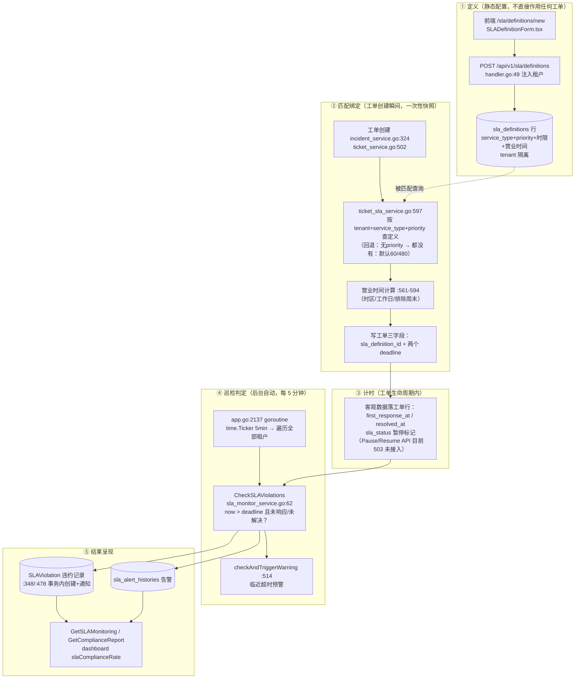

# SLA 合同化与多租户归属专项方案（核查 + 设计 + 审查）

> 状态：**Accepted v1.11（2026-10-14 终审通过，见 §10.2；含闭环/旅程/结算/链路/类型归属/关联语义/对账/严格自建防线/类型受控下发/命名冲突/下发二分法/不覆盖不变量/发布流程，见 §11–§15）**｜日期：2026-10-14｜层级：L4（专项方案，挂接 canon L1 概念权威）
> v1.1 修订：修复审查发现的 2 Blocker（授权表并发唯一性、RLS 登记缺失）与 9 Major（优先级矛盾、fail-closed 表述失实、RLS 测试证据错引、JSON 引用改关联表、并轨双写、接口签名口径、provided 读取路径、scope 授权三件套、验收编号撞号），详见 §10.1。
> v1.2 增补：业务闭环 9 环节走查（§11，1 处缺口）、三角色用户旅程（§12，含差距标注）、结算统一逻辑 D-SLA-8/9（§13，violation 加 dispute 语义、compliance 白名单口径）；代码改进清单 §14。
> v1.3 增补：SLA 定义与作用全链路图（§15，as-is/to-be 对照）；D-SLA-3 修订——service_type 正名为工单类型维度，取值域改租户动态 TicketType，删除 `default → incident` 静默兜底（修复 problem/自定义类型被误按 incident SLA 计时）；工单类型不穿透决策（§15.3）——grant 增 `ticket_type_id` 类型绑定，L1 类型对齐在授权行完成，拒绝跨租户类型引用；下发定义写保护收拢为四层纵深防御（§4.1，回归断言 SLA-A4）。
> v1.4 增补：工单类型与 SLA 关联语义定稿（§15.4/§4.2）——关联全部可选、无必然关系；匹配链扩为 L1→L2→L3a/b/c→L4（新增 L3c 类型无关兜底定义）；发现现状 `sla_enabled=false` 非真豁免缺陷，新增 `TicketType.sla_exempt` 显式豁免 + 报表豁免桶（验收 SLA-A12）。
> v1.5 增补：双方对账机制（§13.5）——三层分离模型（事实层共用/运营层各基准/结算层合同重算）；D-SLA-9 条件③修正（分母看合同覆盖类型范围，不看工单绑定定义——绑定漂移工单不漏出结算）；对账表双口径三列（contract_verdict/internal_verdict/drift_flag，验收 SLA-A13）。
> v1.6 增补：严格自建 SLA 与合同的关系（§13.6）——客户 2h vs 合同 5h：合同覆盖类型 L1 优先（客户单方面加严不生效）、结算层免疫、良性漂移商机信号；新增违约基准过滤防线（客户自建 violation 不进合同结算，matched_layer 过滤 + 重算双保险，验收 SLA-A14，反例第 2 条）。
> v1.7 增补：工单类型受控下发 D-TT-1（§4.5a，P2）——重评 §15.3 决策：受控下发采纳（类型副本物化到 customer + 受控/治理字段分治 + 与 SLA 定义同步经 grant 通道），穿透引用仍拒绝；修复 SLA 下发链路的类型悬空点（验收 SLA-A15）。
> v1.8 增补：命名冲突治理（§4.5a）——不加人读前缀，三层机制：作用域唯一约束（SLA 定义补 unique(tenant_id,name)，工单 19；code 撞车机械后缀 -p<providerTenantID> 仅内部编码）+ origin 溯源 + UI 角标；提炼"受控下发通用模式"（grant→类型→未来目录/模板下发复用同一套）。
> v1.9 增补：下发机制二分法（§4.1b）——SLA 定义用**引用**（条款单一权威版本，结算可信；RLS 授信通道具体形态：USING + EXISTS(grant) 仅 SELECT 放宽、WITH CHECK 锁写）、工单类型用**复制物化**（本租户 FK 必须；副本写入走系统特权上下文 tenantctx 惯例）；判据=消费者是否需本租户行 FK；通用模式补二分决策点。
> v1.10 增补：下发不覆盖不变量（§4.5a INV-1~5）——物化只 INSERT、同步 UPDATE 必带 origin 三元组守卫（native 行 SQL 层物理不可达）、字段白名单、零 DELETE（解绑转 native/删除转 orphaned）、不收编 native；副本带 sync_status 可观测；验收 SLA-A16 + 反例一条。
> v1.11 增补：更新后下发=发布流程（§4.5a）——编辑源（dirty）→ 预览 diff → 逐副本事务发布（受控字段 UPDATE + SLA 定义变更联动 grant 创建/更新 + sync_status + 变更通知）；修正 v1.7 与 v1.9 衔接矛盾（下发类型的 SLA 生效走自动 grant 而非 default_sla_id 跨租户指向）；单副本原子/跨副本可重试；发布只影响其后新工单。
> 触发：对演示环境 `http://172.18.3.238:8089/sla` "新建 SLA 定义" 页面的多租户核查（前端 `itsm-frontend/src/pages/(main)/sla/definitions/new` → `SLADefinitionForm.tsx`，后端 `router/sla_routes.go` → `handlers/sla` → `service/ticket_sla_service.go`）。
> 术语：Provider=`msp_provider`，Customer=`msp_customer`，平台=`internal`，直客=`saas_customer`（对齐 [canon](./msp-concept-model-and-architecture-canon.md) §1 概念总表；部署模式 `private`/`saas`/`saas_msp` 对齐 canon §7）。

---

## 0. 摘要（TL;DR）

当前"新建 SLA 定义"是**单租户内的技术配置**，不是合同级 SLA 管理。租户隔离本身做对了（handler 强制上下文租户、service 层 fail-closed），但三个合同场景核心问题均存在结构性缺口：

| # | 问题 | 结论 |
|---|---|---|
| Q1 | SLA 定义建在哪个租户合理？ | 当前隐含"定义租户 = 工单租户"单一假设；MSP 场景下 provider 建的定义永远匹配不到 customer 租户的工单。**缺口成立** |
| Q2 | 不同 customer 的 SLA 要求不同如何处理？ | 支持客户等级的 `SLAPolicy` 策略引擎已存在但**从未接入生产链路**（`MatchSLAPolicy` 全库仅测试引用）；等级粒度也无法表达同等级客户间的合同差异。**缺口成立** |
| Q3 | 结算时以哪个租户的数据为准？ | 系统无合同/账单实体；计量数据（SLA 时钟、首次响应、解决时间）客观落在 customer 工单上，但报表全部按单一 tenantID 聚合，**provider 无跨客户结算视角**。**缺口成立** |

方案分四批：**P0** 最小闭环（定义下发机制 + 策略引擎接线 + 表单对齐）→ **P1** 合同实体化 → **P2** 结算报表 → **P3** 前端补全。验收与反例见 §8，审查记录见 §10。

---

## 1. 背景与核查范围

### 1.1 核查对象

- 页面：`/sla` → "新建 SLA 定义"（路由 `/sla/definitions/new`，组件级门禁 `sla:write`）
- 前端：`itsm-frontend/src/components/sla/SLADefinitionForm.tsx`（新建/编辑共用表单）
- 后端 API：`POST/GET/PUT/DELETE /api/v1/sla/definitions`（`itsm-backend/router/sla_routes.go:19-33`）
- 绑定链路：工单创建时 SLA 匹配（`service/incident_service.go:324`、`service/ticket_service.go:502` → `service/ticket_sla_service.go:597`）

### 1.2 业务动线（合同视角）

合同型 SLA 的业务动线是：**Provider 与 Customer 签订合同（约定响应/解决时限、营业时间、罚则）→ 平台内建对应的 SLA 目标 → 工单产生时按合同绑定目标 → 周期性出达成率报告 → 按合同条款结算（信用/罚金）**。当前系统只覆盖了中间两步的"技术配置"部分，且归属关系与 MSP 拓扑脱节。

---

## 2. 现状盘点（代码证据）

### 2.1 数据模型

| 实体 | 关键字段 | 证据 | 状态 |
|---|---|---|---|
| `SLADefinition` | name/service_type/priority/response_time/resolution_time/business_hours(JSON)/escalation_rules(JSON)/conditions(JSON)/is_active/**tenant_id** | `itsm-backend/ent/schema/sladefinition.go:13-28` | ✅ 租户隔离完整 |
| `SLAPolicy` | **customer_tier**(platinum/gold/silver/bronze)/ticket_type/priority/response_time_minutes/resolution_time_minutes/business_hours/exclude_weekends/exclude_holidays/escalation_rules/priority_score/**tenant_id** | `itsm-backend/ent/schema/sla_policy.go:18-70` | ⚠️ 模型齐全，引擎未接线（见 2.3） |
| `Tenant` | type=internal/saas_customer/**msp_provider**/**msp_customer**/…、parent_tenant_id、msp_provider_id、plan_code、**billing_enabled**、**currency**、**service_tier**、timezone、quota | `itsm-backend/ent/schema/tenant.go:19-83` | ✅ 拓扑字段齐，billing 仅占位 |
| `MSPAllocation` | msp_user_id / **customer_tenant_id** / **provider_tenant_id**（三方关系，活跃唯一约束） | `itsm-backend/ent/schema/msp_allocation.go:19-53` | ✅ provider-customer 关系已建 |
| `Ticket` | tenant_id、**msp_provider_id**、is_managed_by_msp、msp_ticket_id、sla_definition_id、sla_response/resolution_deadline、first_response_at、resolved_at、sla_status(pause/resume) | `itsm-backend/ent/schema/ticket.go:56-145` | ✅ 计量数据基础具备 |

### 2.2 API 与租户隔离（做得对的部分）

- 所有 SLA handler 一律 `tenantIDVal := c.GetInt("tenant_id")`（`handlers/sla/handler.go:56,84,99,124,…`），**不接受请求体自报租户**；监控 DTO 明确注释"不接受请求体里的 slaDefinitionId/ticketId 等自报字段，避免跨范围注入"（`dto/sla_dto.go:107-109`）。
- service 层 fail-closed **仅覆盖监控/绩效链路**：`ErrTenantRequired` 在 `GetSLAMonitoring`（`service.go:186-188`）与 `ListSLAPerformance`（`:236-238`）入口对 `tenantID <= 0` 直接拒绝。**定义 CRUD（Create/Get/Update/Delete/List，`service.go:43-64`）无该防御**——handler 层 `c.GetInt("tenant_id")` 缺上下文时返回 0，`CreateSLADefinition`（`handler.go:56-71`）可写入 `tenant_id=0` 行（依赖 DB 层 RLS 兜底，应用层无护栏）。**该护栏缺口列入 P0 修复范围**（D-SLA-7，§4.7）。
- RLS 迁移确实覆盖 `sla_definitions`（`database/rls/migrations/004_lifecycle_tables_policies.sql:59`，同批含 sla_metrics/sla_violations/sla_alert_histories；`sla_alert_rules`/`sla_policies` 在 `009_remaining_tables_policies.sql:90`），真实跨租户断言在 `database/rls/rls_integration_test.go:441`。注意：`tests/multi_tenant/rls_matrix_test.go:47` 的 `sla_definitions` 行**目前是空壳占位**（全部 17 张表用例体为空函数），不能作为证据引用——A4 验收基线据此修正。

### 2.3 SLA 绑定链路（实际生效的只有一条窄路径）

工单创建时调用（`service/incident_service.go:321-344`、`service/ticket_service.go:502`）：

```go
// service/ticket_sla_service.go:597-639
CalculateSLADeadlineFromRequest(ctx, tenantID, ticketType, priority)
// 仅按 tenant_id + service_type + priority 查 SLADefinition；
// 精确匹配失败 → 回退"同 service_type 无 priority"；
// 仍失败 → 工单静默无 SLA（仅 warn 日志，工单照常创建）
```

**关键断裂点**：
1. 入参只有 `ticketType + priority`，**没有 customerTier / customerTenant / 合同维度**。
2. `SLAPolicyService.MatchSLAPolicy`（customer_tier + ticket_type + priority 三级特异性匹配，`service/sla_policy_service.go:189-271`）**全库检索仅出现在 `sla_policy_service_test.go`，无任何生产调用方**。
3. `Tenant.service_tier`（客户等级的天然来源）全库仅 DTO 映射引用（`dto/mappers.go`），无业务消费。
4. 匹配失败的现状行为是**静默默认值**而非"无 SLA"：未命中时返回 `SLADefinitionID=0` + 默认 60/480 分钟 deadline（`ticket_sla_service.go:641-649`，仅 warn 日志）→ 合同型 SLA 下会导致**覆盖率虚高、漏报违约**（工单看起来有 SLA，实为系统默认值）。

**补充：存在第二条生效路径**（v1.1 修正）：`service/ticket_service.go:499-501`——当工单类型配置了 `SLAEnabled && DefaultSLAID != 0` 时走 `CalculateSLADeadlineByDefinition`（按类型级默认定义直接绑定），不经属性匹配。该路径在目标匹配优先级中的位置见 D-SLA-2（§4.2，L3a）。

### 2.4 前端表单功能覆盖核查

`SLADefinitionForm.tsx` 实际暴露 7 个字段：name、description、serviceType（自由文本）、priority、responseTime、resolutionTime、isActive。

| 后端能力 | DTO 有字段 | 表单暴露 | 后果 |
|---|---|---|---|
| business_hours（时区/工作日/时段/节假日） | ✅ `sla_dto.go:15` | ❌ | 永远空 map → 按 24x7 计算（`ticket_sla_service.go:561-567` is24x7 分支） |
| escalation_rules / conditions | ✅ `sla_dto.go:16-17` | ❌ | 升级规则无处配置 |
| 客户/等级维度 | ❌（Definition 无此维度；Policy 有但未接线） | ❌ | Q2 缺口 |
| serviceType 枚举对齐 | — | ⚠️ 自由文本 | **隐患**：placeholder 引导填 `standard/premium`，而匹配引擎固定映射为 `incident/service_request/change` 三值（`ticket_sla_service.go:602-612`）→ 用户填错值则**该定义永远匹配不上任何工单** |

### 2.5 结算相关现状

- 全库检索 `billing/settlement/invoice`：仅 `Tenant.billing_enabled`（bool 占位，`ent/schema/tenant.go:50-52`）、`Tenant.currency`、seeder 对 root 租户置位（`pkg/seeder/seeder.go:807,823`）。**无合同、账单、计费周期、SLA 罚则/信用实体。**
- 合规报表 `GetComplianceReport`（`handlers/sla/service.go:407-410`）、监控 `GetSLAMonitoring`（:185）全部按**单一 tenantID** 聚合：provider 登录只能看自己租户（provider 租户内通常无工单），无法按 customer 拆分。
- 有利条件：`Ticket.msp_provider_id` + `is_managed_by_msp` + `MSPAllocation(provider_tenant_id, customer_tenant_id)` 已把"服务商-客户"关系落在工单与分配上，**做 provider 视角跨客户报表只差查询层，不差数据模型**。

---

## 3. 三个核心问题分析

### 3.1 Q1：SLA 定义建在哪个租户合理？

**当前行为**：定义强制归属操作者所在租户（`handler.go:56-68`），匹配按**工单 tenant_id** 查找（`ticket_sla_service.go:623`）。

- `private` 单租户：✅ 合理，自建自用。
- `saas` 直客：✅ 合理（平台与直客按 canon §7 是同实例内 `internal` + `saas_customer`；直客租户自建定义即可）。
- `saas_msp` MSP 场景：❌ 断裂。工单落在 customer 租户（`ticket.tenant_id = msp_customer`），合同是 provider 与客户签的，定义自然建在 provider 租户 → `CalculateSLADeadlineFromRequest(tenantID=customer)` **永远查不到 provider 租户下的定义**。
- 变通方案（每客户租户复制一份定义）：管理错位——合同变更时 provider 无权也无入口更新客户租户内定义；N 个客户 = N 份手工同步，且违反 canon 的"Provider 管客户配置"心智。

**目标口径**：SLA 定义的**所有权在合同签订方（provider）**，**效力达被服务租户（customer）**。实现上引入"provider 创建 + 授权下发到客户租户"（D-SLA-1，§4.1）。

### 3.2 Q2：不同 customer 的 SLA 要求不同，如何处理？

三层缺口：

1. **引擎缺口**：`MatchSLAPolicy` 未接线，`CalculateSLADeadlineFromRequest` 不读 `Tenant.service_tier`。
2. **粒度缺口**：`SLAPolicy.customer_tier` 只有等级（platinum/gold/silver/bronze），**同等级两个客户 SLA 不同时无法表达**——等级是"服务档位"，合同是"客户个案"，两者必须共存。
3. **降级策略缺口**：匹配失败静默无 SLA。合同场景必须 fail-loud（告警 + 报表可见），否则结算争议无据可查。

**目标口径**：匹配优先级 = **合同（customer 个案）> 等级策略（tier）> 租户自建定义 > 无（fail-loud 告警）**（D-SLA-2，§4.2）。

### 3.3 Q3：结算以哪个租户的数据为准？

**当前答案：无法回答——但结论可以先定**：

- **计量数据以工单所在租户为准**：`first_response_at`、`resolved_at`、SLA 时钟暂停/恢复都是 customer 工单上的客观数据，provider 与 customer 看到的是同一份事实（单一数据源，避免"两个租户各算一套"）。
- **合同条款以 provider 租户的定义/合同为准**：时限、营业时间、罚则由合同方定义。
- **结算报表需要 provider 视角按 customer 分组聚合**：新增跨租户只读报表（依据 `ticket.msp_provider_id`），属 canon §2.3"跨租户面"（只读视图，非切换），需走 `provider_tenant_id` 收窄 + 条目级授权。

---
## 4. 目标设计（P0 → P3）

### 4.1 D-SLA-1（P0）：SLA 定义归属与下发机制

**决策**：SLA 定义所有权归 provider（合同签订方），通过"授权下发"使效力达 customer 租户。

**模型变更**（`ent/schema/sladefinition.go`，v1.1 按模型审查修订：删除 scope enum 与冗余有效期，改用活跃唯一约束）：

```text
新增字段：
  owner_provider_tenant_id  int  可空   # 非空=由 provider 创建管理的合同 SLA；NULL=本租户自用（现状）
  # scope enum 删除：self ⟺ owner_provider_tenant_id IS NULL，派生字段不落库（避免双真相来源）
新增授权表（v1.1 改名 grant，避开 canon 的 Scope/ViewFilter 术语撞名；v1.3 增类型绑定维度）：
  sla_definition_grant (
      id,
      sla_definition_id,             # FK → sla_definitions（provider 租户内的源头定义）
      customer_tenant_id,
      provider_tenant_id,
      ticket_type_id     可空,       # v1.3：customer 租户内的工单类型 ID
                                     #   NULL = 类型无关授权（对该客户全部类型生效，匹配低优先级）
                                     #   非空 = 仅对该客户的此类型生效（匹配高优先级）
                                     # L1 匹配的类型维度由 grant 承载（customer 类型 ID 对 customer
                                     # 类型 ID），不做跨租户编码字符串匹配（见 §15.3 不穿透决策）
      valid_until        可空,       # 单边有效期：NULL=长期；完整合同期由 P1 Contract 承载
      is_active,
      created_at, updated_at,
      -- Blocker-1 修复："同一 customer 同时只有一个生效授权"的并发正确性
      UNIQUE (customer_tenant_id) WHERE is_active = TRUE
      -- partial unique index，谓词仅用不可变的 is_active 判断；
      -- 不可用 valid_until > now() 作谓词（非不可变函数，PG 拒绝）。
      -- 应用层配套：激活新授权前必须先关闭旧授权（deactivate-then-activate 事务），
      -- 合同续签重叠窗口由"先关旧再开新"消除；
      -- 未来若需重叠灰度，升级为 exclusion constraint
      -- (customer_tenant_id WITH =, daterange(valid_from,valid_until) WITH &&)（手写迁移 SQL）
  )
```

**匹配语义**（`ticket_sla_service.go` 改造，v1.1 修正 v1.0 的优先级矛盾——统一以本节 L 编号为准，§4.2 的 L1-L4 与此对齐）：
1. **L1**：查 `sla_definition_grant` 中对当前 customer 租户生效的下发定义（合同个案优先）；
2. **L2**：等级策略（D-SLA-2）；
3. **L3**：租户自建域——L3a 类型级默认（`ticket_service.go:499-501` 的 `SLAEnabled && DefaultSLAID` 路径）优先于 L3b 属性匹配（现状 `CalculateSLADeadlineFromRequest`），两者同为"自建定义"层；
4. **L4**：全未命中 → fail-loud（见 D-SLA-2）。

**租户隔离不变量**（v1.1 补齐授权三件套与 RLS 通道）：
- **所有权**：provider 只能创建/修改 `owner_provider_tenant_id = 自己` 的定义；定义行 `tenant_id` = provider 租户（RLS 天然隔离）。
- **customer 读取路径（v1.1 明确：独立端点，不开列表跨租户读洞）**：新增 `GET /api/v1/sla/definitions/provided`（customer 面，只读，按 grant 授权行 join），**不**放宽 `ListDefinitions` 的 tenant_id 过滤、**不**放宽 `sla_definitions` 的 FORCE RLS 策略（`004_lifecycle_tables_policies.sql:59`）；customer 列表页分两段渲染"自建 / 服务商下发"（R-SLA-2 落到 API 层）。
- **customer 对下发定义的写保护（v1.3 收拢为四层纵深防御，逐层独立成立）**：
  ① **应用层租户作用域**：现有 `UpdateSLADefinition` 先 `GetDefinition(id, tenantID)`（`handler.go:132`）、repo 层 `UpdateOneID(id).Where(TenantID(...))`（`repository_impl.go:103-104`）——customer ctx 下 provider 定义天然 404，现状机制直接复用，无需新增代码；
  ② **DB 层 RLS**：定义行 `tenant_id`=provider 租户，customer 会话被 FORCE RLS 拦截写路径（`004_lifecycle_tables_policies.sql:59`）；
  ③ **权限层**：provided 端点只注册 GET（无 PUT/DELETE 路由入口），`sla:write` 仅作用于本租户定义；
  ④ **UI 层**：两段式列表中下发段不渲染编辑/删除按钮。
  回归断言 = SLA-A4（customer PUT/DELETE 下发定义 → 403/404，四层任一命中即通过，全通过才验收）。
- **授权行归属与 RLS（v1.1 补 Blocker-2；v1.9 通道具体化）**：`sla_definition_grant.tenant_id` = **provider 租户**（授权是 provider 的资产，写入走 provider ctx）；customer 端只读查询走**显式跨租户只读通道**（canon I7/B1：跨租户仅经显式授权通道——grant 行本身即授权凭据）。通道具体形态（v1.9）：`sla_definitions` 的 RLS USING 增加授信可见子句（仅 SELECT 路径放宽）`... OR EXISTS (SELECT 1 FROM sla_definition_grants g WHERE g.sla_definition_id = sla_definitions.id AND g.customer_tenant_id = current_setting('app.current_tenant')::int AND g.is_active)`；写路径由 WITH CHECK（`tenant_id = 当前租户`）锁死——customer 对 provider 定义行**可见（有授权时）不可改**，四层写保护（上）不变；grant 表自身 policy 同批登记。
- **授权三件套**：
  1. **权限码**：grant 写入端点新增 `sla:grant:write`（provider_admin 持有），不与 `sla:write` 混用；登记进 role-permission-extension-checklist；
  2. **事务内归属校验（防 TOCTOU）**：写入 grant 前同一事务内 `SELECT ... FOR UPDATE` customer 租户行并校验 `customer.msp_provider_id == provider_tenant_id`（与 `tenant_guard_consistency`/mspguard 不变量同源）；
  3. **解绑级联失效**：customer 的 `msp_provider_id` 变更/解绑时，同事务将其全部 grant 置 `is_active=false`。

**明确不做**：跨租户直接 UPDATE customer 租户内的定义实体（provider 永远改自己租户内的源头，避免双写）；放宽 `sla_definitions` 列表过滤与 RLS（读取走独立端点）。

### 4.1b 下发机制二分法（v1.9 增补，终审问答定稿：复制还是引用？）

**结论：按实体性质二分——SLA 定义用"引用"，工单类型用"复制物化"。判据：消费者是否必须以本租户行 FK 引用该实体。**

| | SLA 定义（合同条款） | 工单类型（运营载体） |
|---|---|---|
| 机制 | **引用**（不复制） | **复制物化**（D-TT-1 副本） |
| 目标租户里的东西 | 无定义行——仅 grant 授权行（且授权行在 provider 租户） | 一行真实 TicketType 副本（origin=controlled） |
| 为什么 | 条款必须单一权威版本：结算重算基准（§13.5）、provider 改一次全网生效；复制产生 N 份可漂移副本，结算不可信 | 类型必须租户本地存在：`ticket.tenant_id` 作用域 FK、`unique(code, tenant_id)`、建单解析严格本租户（`ticket_core_service.go:131-133`）——引用式跨租户 FK 已被 §15.3 拒绝 |
| customer ctx 读取 | 匹配 L1 / provided 端点走 RLS 授信通道（上）；工单创建后 deadline 快照在工单行内，判违约不回读 provider 行；显示定义名经 provided 端点富化 | 工单/建单引擎直接读本租户副本行，零跨租户 |
| customer ctx 写入 | 无（四层写保护） | 无（受控字段锁 + RLS；下发写入走系统特权上下文） |

**副本写入的特权通道（v1.9 明确）**：D-TT-1 物化副本在**系统特权上下文**执行（仓库既有惯例：`common/tenantctx/tenantctx.go:63` 明示 system ctx 用于 migrations/seed jobs/cron workers/**MSP admin ops**——类型下发属此类）；前置归属校验仍走授权三件套事务；常规 provider/customer 会话被 RLS 拦截，不构成旁路。

**SLA 引用的完整数据流（谁写哪行/谁读哪行）**：

```text
写（全在 provider 租户，customer 租户零写入）：
  定义 CRUD → sla_definitions（tenant_id=provider）
  授权     → sla_definition_grants（tenant_id=provider）
读（customer ctx）：
  ① 匹配：L1 = grants(customer_tenant_id=ctx, is_active) JOIN 定义行（RLS 授信通道）
  ② 展示：GET /sla/definitions/provided（同通道）
  ③ 工单创建后：sla_definition_id 存引用 ID，deadline 快照在工单行内——
     客户报表判违约只用工单自身字段（不回读 provider 行）；定义名展示走 ② 富化
结算重算（provider ctx）：直接读自家定义行 + 工单客观时间（§13.5）——引用模式下
  条款版本始终唯一，无副本漂移问题
```

**受控下发通用模式 v1.9 修正**：模式增加〔二分决策点〕——
源头唯一 + 授权通道 + **〔引用 vs 副本：消费者需本租户行 FK？是→副本（工单类型、未来目录项），否→引用（合同条款类实体）〕** + 受控字段分治 + origin 溯源 + 发布同步 + 解绑处置 + 作用域唯一约束。

### 4.2 D-SLA-2（P0）：策略引擎接线 + 匹配优先级

**决策**：把已存在的 `SLAPolicyService` 接入生产链路，形成匹配链（v1.4 扩为 L1→L2→L3a/L3b/L3c→L4，并前置豁免开关）：

```text
工单创建 → 类型显式豁免？（TicketType.sla_exempt=true，v1.4 新增，默认 false）
   是 → 跳过全部匹配，工单标记 SLA 豁免，报表"豁免"桶（有意不配，区别于"未绑定"疏漏）
   否 ↓
匹配优先级（先到先得，与 §4.1 匹配语义同一套 L 编号）：
  L1 合同/下发定义（D-SLA-1 grant：显式类型绑定 > 类型无关授权 NULL）
  L2 等级策略（SLAPolicy，customer_tier + ticket_type + priority 三级特异性匹配，MatchSLAPolicy 现成）
  L3 租户自建域：
     L3a 类型级默认（sla_enabled=true && default_sla_id!=0，ticket_service.go:499-501）
     L3b 属性匹配（现状 FromRequest：动态类型 + 优先级，含无优先级回退）
     L3c 类型无关租户默认定义（service_type 为空的自建定义，v1.4 新增）
     —— 取代硬编码 60/480 的兜底地位，成为租户可控的"默认 SLA"
  L4 无匹配 → fail-loud：工单创建成功，保持现状默认值（SLADefinitionID=0 + 60/480 分钟），
     但新增：SLA 绑定告警事件 + 报表"未绑定"桶；禁止无痕静默降级
```

**v1.4 关联语义定稿（回答"类型与 SLA 是必选还是可选"）**：全部关联机制均为可选，SLA 与工单类型**无必然关系**——类型只是匹配的过滤维度，不是 SLA 的存在前提。四机制：① 类型默认直绑（可选，L3a）；② 授权类型绑定（可选，L1）；③ 属性匹配（无需显式关联，L3b）；④ 类型无关兜底定义（可选，L3c）。没有类型也能有 SLA（L1 类型无关 grant / L3c 兜底），有类型也可能没 SLA（L4）。`sla_enabled` **保持现状语义**（仅 L3a 直绑开关，不参与 L1/L2/L3b——改语义会使存量 `sla_enabled=false` 类型丢失属性匹配 SLA，违反"L3 行为不变"）。

**v1.4 新增字段**：`TicketType.sla_exempt bool`（默认 false，零回归）——租户"故意不要 SLA"的类型（如咨询类）显式豁免，其工单不进 fail-loud 告警、报表单列豁免桶；结算白名单（D-SLA-9）中豁免工单与未绑定工单同样不进分母。验收项 SLA-A12（§8）。

**customerTier 来源（v1.1 口径统一，接口签名不变）**：不修改 `CalculateSLADeadlineFromRequest` 签名（`ticket_sla_service.go:28-29` 接口已固化，调用方 2 处 + 测试 9 处）；service 内部用已在手的 tenantID 查 `Tenant.service_tier` 一次（可短 TTL 缓存）。删除 v1.0 的"增加 customerTier 入参"表述。

**fail-loud 告警载体与字段白名单（v1.1 补）**：告警事件复用 `sla_alert_histories`（RLS 已覆盖，`004_lifecycle_tables_policies.sql:59` 同批），不新建表；**事件体字段白名单（防 provider 商业信息泄露给 customer）**：仅 `ticket_id / ticket_type / priority / occurred_at / reason_code`——不含 provider 定义名/描述/owner_provider_tenant_id/grant 信息；provider 侧未绑定明细放 provider 面报表（D-SLA-5）。

**开关（v1.1 修正 flag 语义，仓库无 flag 基建）**：新增配置项 `SLA_UNBOUND_ALERT_ENABLED`（env/config，默认 false）仅控制 L4 告警事件写入；L1/L2 为纯新增层级无需开关，上线即生效（行为增量安全：未配置 grant/tier 的租户自动跳到 L3 现状逻辑）。

**存量兼容**：L1/L2 为新增层级，L3 行为完全不变；`private`/`saas` 部署（无 provider 无 grant、`service_tier` 为空）自动等效现状。`DEPLOYMENT_MODE` gate 按 canon §7 现状/目标分列：现状 `saas`/空/未知值 MSP 开启（R12），目标仅 `saas_msp`（I12）——grant 写入端点在非 `saas_msp` 模式下 404，实现时按 R12 收口（未知值 fail-closed）。

### 4.3 D-SLA-3（P0）：前端表单对齐 + 工单类型口径修正（v1.3 修订）

1. `serviceType` 从自由文本改为**受控枚举**，且**取值域升级为租户动态工单类型**（v1.3 修订，源于终审前问答确认的口径问题）：
   - **现状问题**：`ticket_sla_service.go:602-612` 把 `service_type` 硬编码映射为三值（incident/service_request/change）且 `default → incident` 静默兜底——**problem/request/租户自定义类型工单会被错误地按 incident SLA 计时**；前端 placeholder 还引导填 `standard/premium`（永远匹配不上）。
   - **修订**：表单下拉从租户 `TicketType` 配置读取（动态类型）；`service_type` 字段正名——它实质就是工单类型的粗粒度化身；匹配引擎 switch 改为查 TicketType 表解析，**删除 `default → incident` 兜底**（未知类型 → L4 fail-loud）。
   - **SLAPolicy.ticket_type 取值域同步**：现有四值枚举（incident/problem/change/request，`sla_policy.go:29-31`）与动态类型并存期间，L2 匹配仅对枚举内类型生效，自定义类型走 L1/L3（文档登记，不阻塞 P0）。
   - 旧数据展示原值并标记"不生效，请迁移"（保留 v1.1 行为）。
2. 新增**归属提示**：表单顶部说明当前定义归属租户及生效范围；provider 上下文创建时提示"该定义需下发授权后才对客户工单生效"（P0 可先文案提示，grant 选择器 P3 补全）。

### 4.4 D-SLA-4（P1）：合同实体化

**决策**：新增 MSP SLA 合同实体（v1.1 命名 `msp_contract`，避免与既有 `ent/schema/contract.go`（vendor 合同，`contract_number` 全局 unique）撞表名/类型名；tenant 内唯一性照搬 `support_contract.go:39-43` 的 `unique(tenant_id, normalized_contract_number)` 惯例），把"SLA 条款 + 合同期 + 罚则"从 SLA 定义中解耦。这是 Q1/Q2/Q3 的完整答案载体。

```text
msp_contract (
    id,
    provider_tenant_id,          # 合同签订方（甲方为 provider 视角）
    customer_tenant_id,          # 被服务方
    contract_no,                 # 合同编号；unique(tenant_id, contract_no)（tenant 内唯一）
    name, effective_from, effective_until,
    status: draft|active|expired|terminated,
    penalties JSON,              # 违约条款（值对象）：{metric, threshold, credit_rate, cap}
    settlement_cycle: monthly|quarterly|on_demand,
    currency,                    # 结算币种（默认取 customer.currency）
    tenant_id,                   # 归属 provider 租户（RLS 收窄）
    created_at, updated_at
)

msp_contract_sla_bindings (      # v1.1：定义引用改关联表，不用 JSON 数组
    id,
    contract_id,                 # FK → msp_contract
    sla_definition_id,           # FK → sla_definitions（owner=provider）
    unique(contract_id, sla_definition_id),
    created_at, updated_at
    # 理由：跨实体引用需外键完整性（definition 删除/停用时合同不悬空）、
    # 可反查（结算报表需要"某 definition 被哪些合同引用"）、可唯一去重；
    # 仓库先例：contract.go:34（vendor edge）、support_contract.go:30-36 全部 edge+FK，
    # 无一例 JSON 存引用。data_source_tenant 字段删除：Q3 已定固定=customer_tenant_id，
    # 恒等字段不落库，查询时 join 即可。
)
```

**与 D-SLA-1 的关系（v1.1 补并轨闸门，消除双写窗口）**：P0 的 `sla_definition_grant` 是 P1 的退化形态（只有授权、没有条款/周期/罚则）。P1 并轨时：① 存量 grant 行 `INSERT INTO msp_contract_sla_bindings SELECT ...` 单向搬迁；② **匹配 L1 查询切到合同链路的同一提交中，grant 写入端点硬关闭（内部代理到合同创建或直接 410），写入口不分叉**；③ grant 表转只读保留一个观察周期后归档。**不做双轨长期并存，写入口从 P1 合并提交起唯一化。**

**匹配升级**：L1 从"查 grant 表"升级为"解析 customer 当前生效合同 → 取合同引用的定义集"（L1 语义不变，实现替换）。

### 4.5 D-SLA-5（P2）：provider 视角结算报表

**决策**：计量数据以工单租户（customer）为准；报表按 provider 收窄、按 customer 分组。

```text
新增端点（挂 /api/v1/providers/sla/... 或 msp 工作台扩展，router 归属 provider 面）：
  GET /sla/settlement-report?customerTenantId=&from=&to=
    - 权限（v1.1 统一为专用权限码，替代 v1.0 的 msp:read）：sla:settlement:read
      （provider_admin/provider_agent 按需分配；含合同罚则/信用额属敏感面）
    - 条目级校验（防先查后滤信息泄露）：customerTenantId 归属校验
      （msp_provider_id == ctx provider，事务内同源）必须在取数前完成，
      越权直接 403 且响应不携带任何分页 total/计数；
      middleware（RequireMSPPermission）只管用户权限面，归属校验在 handler/service 层
    - 数据源：tickets WHERE msp_provider_id = :provider
      （计量的单一事实来源仍是工单行本身，避免另起汇总表与事实漂移；
       数据量增大后再物化汇总，物化表必须带数据窗口与重算任务）
  返回：按 customer 分组的 SLA 达成率/违约明细/按合同 penalties 计算的信用额
```

**与 canon 对齐**：这是"跨租户面"的**只读报表**，不引入 Scope 切换；条目级授权按 `msp_provider_id` 收窄（canon B6：过滤器只改看什么，授权按资源租户）。

### 4.5a D-TT-1（P2）：工单类型受控下发（v1.7 新增，终审问答重评 §15.3 决策）

**问题**：provider 建的 SLA 定义（如"硬件故障 2h 响应"）下发后，需要 customer 侧存在对应的工单类型才能挂 grant 的类型绑定。现状下该类型由 **customer 自己建**——provider 的 SLA 下发链路存在悬空点：授权依赖客户先手工建出匹配的类型，SLA 覆盖完整性依赖客户配合，MSP 标准化服务（同名类型、统一 SLA 基准）无法规模化交付。

**v1.7 重评结论：需要做，但载体是"受控下发"而非 v1.3 拒绝的"穿透引用"**——两者关键区别：

| | 穿透引用（v1.3 拒绝） | 受控下发（v1.7 接受） |
|---|---|---|
| 类型实体归属 | 工单引用 provider 租户的类型行（跨租户 FK） | 下发时在 **customer 租户内物化一份副本**，工单只引用本租户行 |
| RLS | 需新开跨租户读通道 | 零跨租户读——副本就是普通 customer 租户行 |
| customer 修改权 | 无（实体在 provider 侧） | **受控**：受控字段锁定，治理字段可调 |
| 与既有先例一致性 | 无先例 | 与 SLA grant 同款"源头唯一+授权下发+物化副本"模式（§4.1）；仓库另有 `ServiceCatalogItem.sla_id` 目录项挂 SLA 的近亲先例 |

**模型（下发副本标记 + 受控字段分治）**：

```text
TicketType 增补：
  origin             enum native|controlled  默认 native   # native=客户自建（现状不变）
                                                                # controlled=provider 下发副本
  origin_provider_tenant_id  int64 可空                    # 下发源
  origin_type_id     int64 可空                             # provider 源类型行 ID（追溯/同步定位）
  controlled_by_provider  bool 默认 false                   # true=受控字段锁

受控/治理字段分治（customer 权限边界）：
  受控（customer 不可改，provider 版本发布时同步覆盖）：
     name / description / sla_enabled / default_sla_id（指向下发 SLA 副本）
  治理（customer 可调，不改语义基准）：
     icon / color / sort_order / auto_assign_enabled / assignment_rules / notification_config
  不下发（永远 customer 自治）：workflow_definition_key / approval_* （客户流程自治，§15.3 决策延续）

下发 SLA 定义随类型一并联动（v1.11 修正 v1.7 与 v1.9 的衔接矛盾）：
  v1.7 原文"default_sla_id 指向 customer 租户内的定义副本"作废——v1.9 已定 SLA 定义
  为引用模式（不复制），且跨租户指向在匹配查询（本租户 ctx + RLS）下不可行。
  修正：受控下发类型的 SLA 生效通道 = 下发时**自动创建对应 grant**（customer=目标租户，
  type=副本类型，来源=源类型关联的定义）→ 工单创建时 L1 命中（个案优先，语义等价直绑）；
  副本类型 default_sla_id 保持空（sla_enabled 仅作展示标记）。
  优点：与引用模式一致（定义唯一版本）、复用 grant 授权三件套与 RLS 通道、
  解绑级联（grant 失效）天然生效。
```

**同步语义**：provider 更新源类型（如改 SLA 基准）→ 发布动作把受控字段推送到全部下发副本（走显式"发布"而非静默覆盖，customer 侧留变更通知）；customer 侧不可绕过受控锁（handler 校验 `controlled_by_provider` + RLS 二次兜底同 §4.1 四层模型）。**解绑级联**：provider-customer 解绑时下发副本转 native（保留治理字段，受控字段解锁——不删类型避免存量工单类型悬挂）。

**更新后下发 = 发布流程（v1.11 定稿，终审问答）**——provider 修改源类型后的完整生命周期：

```text
provider 侧动作序列（显式三步，绝不静默）：
  ① 编辑源类型（provider 租户内自由改：受控字段/关联 SLA 定义/时限等）
     —— 源与副本此时刻意不一致（dirty），customer 侧副本列表显示"有可用更新"
  ② 预览发布：系统生成 diff（每个目标副本：受控字段旧值→新值、SLA 定义变更、
     将自动创建/更新的 grant），provider 确认影响面
  ③ 执行发布：按副本逐个事务——
     a) 受控字段 UPDATE（INV-2 origin 三元组守卫 + INV-3 字段白名单）
     b) 源类型关联的 SLA 定义有变 → 同步创建/更新对应 grant
        （引用模式：定义行不动，动的只是授权与 grant.ticket_type_id 指向）
     c) 副本 sync_status=synced / last_synced_at=now；customer 侧变更通知
     d) 失败副本标 failed 可重试（部分成功可观测；INV-4 零 DELETE 兜底）

customer 侧感知：
  - 发布前：副本列表显示"有可用更新"（dirty 状态）——变化可预期
  - 发布后：受控字段更新通知；治理字段（客户调过的）原样保留（INV-3）
  - 异议出口：认为发布不合理 → D-SLA-8 争议 / 与 provider 协商；
    不是本地改受控字段（四层写保护）

时序语义（防半更新误解）：
  单副本内字段+grant 原子（一个事务）；跨副本非全局原子——
  provider 看到部分 synced/failed 的发布报告，逐副本重试收敛；
  工单侧无中间态风险：每张工单 deadline 快照创建时已定（§15.1），
  发布只影响其后的新工单（§15.1 易误解点①）
```

**明确不做**：provider 类型目录的"引用式共享"（工单跨租户引用 provider 类型行——v1.3 拒绝原因全部继续成立）；下发 workflow/审批链（客户流程自治）；静默同步（provider 改动必须显式发布）。

**命名冲突治理（v1.8 增补，终审问答定稿）——不加人读前缀，三层机制**：

```text
原则：多租户数据隔离靠 tenant_id 行级隔离，不靠名字空间约定；
     前缀污染用户可见文案、且无法真正消解冲突（只让冲突变形），仓库 157 表先例全站无前缀。

① 作用域唯一约束（数据层）：
   TicketType：unique(code, tenant_id) 现有已够——副本与客户自建类型同域竞争 code；
     下发物化遇 code 撞车 → 机械后缀去重：code 追加 "-p<providerTenantID>"（如 hw_fault-p7）
     ——仅 code 字段（API/集成用编码）机械去重，name（界面显示名）保持 provider 原名不动；
   SLADefinition：现状 name 无任何唯一约束（schema 已验证）——v1.8 补 unique(tenant_id, name)
     （新建校验 + 存量清洗一次性脚本），下发副本同名冲突同款机械后缀。
② 溯源标识（数据层）：冲突的判断与治理不靠名字，靠 origin/origin_provider_tenant_id/
   origin_type_id（D-TT-1）+ owner_provider_tenant_id（SLA 定义）——同名条目归属可程序化判定。
③ 显示区分（UI 层）：两段式列表下发段角标"服务商下发"——用户可辨识，名字本身干净。

通用性（v1.8 提炼）：grant（SLA 下发）→ D-TT-1（类型下发）→ 未来目录/模板下发，
   均复用同一"受控下发模式"：源头唯一 + 授权通道 + 物化副本 + 受控字段分治 +
   origin 溯源 + 发布同步 + 解绑转 native + 作用域唯一约束（含撞车机械后缀）。
   后续 provider→customer 配置下发需求不再逐项重新发明。
```

**不覆盖不变量（v1.10 增补，终审问答定稿：下发不覆盖目标租户数据）**——下发/同步/解绑全路径的五条硬约束，实现期作为 code review 检查单：

```text
INV-1 物化只 INSERT：下发物化绝不 UPDATE 目标租户已有行；
      code 撞车 → 机械后缀新行（v1.8）；unique(code,tenant_id) 约束 + INSERT-only 双保险
INV-2 同步守卫：发布同步的每条 UPDATE 必带 origin 三元组 WHERE——
      origin='controlled' AND origin_provider_tenant_id=:self AND origin_type_id=:源ID
      → native 行在 SQL 层物理不可达（应用层 bug 也碰不到客户自建类型）
INV-3 字段白名单：同步只覆盖受控字段（name/description/sla_enabled/default_sla_id）；
      治理字段（icon/color/排序/分派/通知）永不在 provider 写路径内
INV-4 永不 DELETE：下发/发布/解绑路径零 DELETE；解绑=副本转 native；
      源类型删除 → 副本标 orphaned 保留；有工单引用的类型任何路径不可删
INV-5 不收编：下发不把 customer 现有 native 类型转为 controlled——存量类型标准化
      是客户侧显式动作（自行把 default_sla_id 指向下发定义副本），不在下发路径内
```

**唯一的"覆盖"即契约本身**：发布同步覆盖 controlled 副本的受控字段——被 INV-2（行级守卫）+ INV-3（字段级白名单）双重限定。**同步一致性**：发布按副本逐个事务执行，副本带 `sync_status / last_synced_at`，部分失败可观测可重试（短暂不一致，无数据丢失）。

**批次**：P2（依赖 D-SLA-1 grant 通道 + D-SLA-5 已稳定后做——类型下发是 SLA 下发的放大器，先让 SLA 闭环跑通再扩类型维度；无强依赖冲突）。验收 SLA-A15（§8）+ SLA-A16（§8，五条不覆盖回归）。工作量：+6–8 人日（P2 批次 10–11 → 16–19）。

### 4.6 D-SLA-6（P3）：前端补全

1. SLA 表单补齐 businessHours（时区/工作日/时段/节假日——后端 `BusinessHoursConfig`（`sla_policy.go:83-89`）结构可直接对齐）、escalation_rules、conditions；
2. provider 上下文的"适用客户"多选（**P1 后唯一写入口为 msp_contract + bindings**；P0 期间临时写 grant 表，P1 合并提交时随写入口唯一化一并切换，见 §4.4 并轨闸门）；
3. provider 视角 SLA 报表页（挂 reports 菜单，`dashboard_routes.go:288` 已有 `/reports/sla` 位形可参考）。

### 4.7 D-SLA-7（P0）：存量护栏补齐（v1.1 新增，源自安全审查 Major-1）

定义 CRUD 补齐 fail-closed：`CreateDefinition/GetDefinition/UpdateDefinition/DeleteDefinition/ListDefinitions` 入口对 `tenantID <= 0` 返回 `ErrTenantRequired`（对齐 `GetSLAMonitoring` 既有写法 `service.go:186-188`），杜绝 `tenant_id=0` 行写入；handler 层 `strconv.Atoi` 错误不再静默忽略（非法 id 显式 400，Minor 顺手修）。

---

## 5. 实施批次

| 批次 | 内容 | 涉及 | 验收锚点 |
|---|---|---|---|
| **P0** | D-SLA-1（定义下发+grant）+ D-SLA-2（引擎接线+四级匹配+fail-loud）+ D-SLA-3（表单枚举）+ D-SLA-7（CRUD 护栏） | `ent/schema/sladefinition.go`、新 `sla_definition_grant`、**RLS policy 登记（`database/rls/` 新迁移：grant 表 policy + customer 只读通道，v1.1 补 Blocker-2）**、`ticket_sla_service.go`、`incident_service.go`/`ticket_service.go` 调用点、`SLADefinitionForm.tsx` | SLA-A1–A4、SLA-A8–A9 |
| **P1** | D-SLA-4 合同实体化（msp_contract + bindings）+ grant 并轨（写入口唯一化） | 新 `ent/schema/msp_contract.go`/`msp_contract_sla_binding.go`、**RLS policy 登记**、存量 grant 搬迁 SQL、匹配 L1 实现替换 | SLA-A5 |
| **P2** | D-SLA-5 结算报表 | 新 handler/repo 查询、msp 路由、`sla:settlement:read` 权限登记（走 role-permission-extension-checklist） | SLA-A6、SLA-A10 |
| **P3** | D-SLA-6 前端补全 | 表单、报表页 | SLA-A7 |

**依赖与顺序**：P0 内 D-SLA-1/2/3/7 可并行开发但需一起验收；P1 依赖 P0 的 grant 概念；P2 依赖 P1 的合同罚则（无合同也可出达成率报表，罚则列为空）；P3 独立可穿插。

**回滚**：P0 全部为增量字段/新增层级，L3 匹配行为不变，可整体回退（新增层级无开关、回退=回滚提交；唯一开关 `SLA_UNBOUND_ALERT_ENABLED` 仅控告警写入，见 §4.2）；P1 合同实体为新增表 + grant 写入口切换，回滚需保留 grant 写入口代理一版；P2 只读报表可独立下线。

---

## 6. 风险与开放问题

| # | 风险/开放问题 | 处置 |
|---|---|---|
| R-SLA-1 | `serviceType` 历史自由文本数据（如 `standard`）与新枚举不兼容 | D-SLA-3 展示原值+迁移标记；提供一次性迁移脚本（standard→incident 或明确废弃），执行前统计影响行数 |
| R-SLA-2 | provider 下发定义后，customer 管理员看到"不属于自己的可编辑列表"产生困惑 | customer 侧列表区分"自建/下发给本租户"两段；下发定义只读标识 |
| R-SLA-3 | `Tenant.service_tier` 取值无字典约束（自由字符串），L2 匹配可能永远落空 | P0 先按精确匹配（与 SLAPolicy.customer_tier 枚举对齐的值才生效），文档登记取值域；P1 可考虑字典化 |
| R-SLA-4 | fail-loud 告警风暴（大量存量无 SLA 工单在上线后集中触发） | 告警事件按 tenant+类型聚合去重；首次上线仅报表可见不触发通知，观察一周后开启 |
| R-SLA-5 | 结算报表跨租户读的性能与权限放大 | 强制 msp_provider_id 索引；条目级校验在取数前完成（handler/service 层，非仅 middleware），越权响应不携带分页 total（防先查后滤信息泄露，v1.1 补） |
| O-SLA-1 | （开放）SLA 暂停/恢复计时与合同"除外时间"（如客户侧停电）条款如何映射 | P1 合同 penalties 设计时一并定义 pause_reason 字典与合同除外条款的映射 |
| O-SLA-2 | （开放）incident 与 ticket 两套工单体系的 SLA 字段重复（schema/ticket.go 与 incident 实体各有一份 sla_* 字段），报表口径需统一 | P0 报表先按 ticket 表；统一口径在 P1 合同期设计时收口 |
| O-SLA-3 | （开放）`saas` 直客模式下"平台=provider"的合同由哪个租户持有 | 对齐 canon §2.2：当前 default 租户同体；P1 合同建议挂 saas_customer 自租户（自建自用），避免依赖 R7/R8 未收敛的平台拆分 |

---

## 7. 与既有文档/编号的关系

- **canon（L1）**：本方案复用其 Provider/Customer/部署模式定义与跨租户面边界（§2.3），不新增概念名词；`sla_definition_grant`/`msp_contract` 属 Workflow 域（C13）租户内实体 + 授权行，跨租户规则遵循 §6 子系统挂接规范。
- **编号登记（v1.1 补，架构审查 Major-2；✅ 已完成 2026-10-14，随 §10.2 终审）**：本文档本地编号前缀 `D-SLA-1~9`（设计决策）、`D-TT-1`（类型受控下发）、`R-SLA-1~5`/`O-SLA-1~3`（风险/开放）、`SLA-A1~A17`（验收）、`INV-1~5`（下发不覆盖不变量）——验收编号 `SLA-` 前缀避免与 canon `A1–A12` 撞号；**已注册进 canon 附录 C.2 编号注册表（canon 修订记录 v1.8 同步）**。
- **INDEX 登记（✅ 已完成 2026-10-14）**：本文已录入 `docs/multi-tenant/INDEX.md` §2 文档清单（L4 层级，Accepted v1.11）。
- **07-known-gaps.md（G 空间）**：本文 Q1–Q3 缺口建议在 G 空间登记（评审后由维护者定编号，避免本文私发 G 编号违反"唯一 G 空间"约定）。
- **backlog.md（OB 空间）**：P1–P3 批次可拆 OB 条目。
- **role-permission-extension-checklist.md**：P2 新端点需走扩展评审清单（provider 面 `sla:settlement:read` 类权限码的归类/登记）。
- **msp-implementation-plan.md（IP 编号）**：本方案不占用 IP 编号（该空间属主实施计划），评审通过后如需并入主计划再登记。

---

## 8. 验收标准（DoD）

| # | 验收项 | 场景 | 期望 |
|---|---|---|---|
| SLA-A1 | 下发匹配 | provider 建 SLA → grant 授权到 customer 租户 → customer 租户建 incident（customer 自建无此定义） | 工单绑定该定义，deadline 按 provider 定义+营业时间计算 |
| SLA-A2 | 匹配优先级 | 同一 customer：有 tier 策略也有下发定义 | L1 下发定义胜出（合同个案优先于等级档位） |
| SLA-A3 | fail-loud | 租户无任何可匹配定义 | 工单创建成功、保持现状默认值（ID=0+60/480），产生绑定告警事件（白名单字段）、报表"未绑定"桶 +1 |
| SLA-A4 | 隔离回归 | customer 用户尝试 PUT/DELETE 下发给自己的定义；尝试读非授权 provided 定义 | 403/404（fail-closed）；`database/rls/rls_integration_test.go` 新增 grant/下发定义跨租户断言（v1.1：不依赖空壳矩阵测试，或先补实矩阵） |
| SLA-A5 | 合同期 | 合同过期后该 customer 新建工单 | L1 不再命中过期合同定义，降级 L2/L3 或 fail-loud |
| SLA-A6 | 结算报表 | provider 用户查询结算报表 | 仅见归属自己的 customer 分组数据；越权 customerTenantId 在**取数前** 403 且响应无任何计数 |
| SLA-A7 | 表单防错 | 新建 SLA 填 serviceType | 枚举下拉三值；旧值数据展示"不生效"标记 |
| SLA-A8 | fail-closed 回归（v1.1 新增） | 无租户上下文调用 SLA 定义 CRUD | 全部 401/403，不产生 `tenant_id=0` 数据行 |
| SLA-A9 | 解绑级联（v1.1 新增） | customer 与 provider 解绑（msp_provider_id 变更）后新建工单 | 存量 grant 已失效，新工单不命中下发定义，降级 L2/L3 或 fail-loud |
| SLA-A10 | 信息泄露（v1.1 新增） | customer 侧查看下发定义与告警事件 | 仅白名单字段（无 provider 定义名/描述/罚则/grant 信息）；事件体同白名单 |
| SLA-A11 | 结算口径白名单（v1.2 新增，§13.2） | 合同期内出结算报表 | 分母=合同绑定定义覆盖的工单；未绑定/豁免工单不进分母，waived/未裁决 disputed 不计违约 |
| SLA-A12 | 类型豁免（v1.4 新增，§15.4） | `sla_exempt=true` 的类型建工单 | 跳过全部匹配、无告警、报表豁免桶 +1；该类型 `sla_enabled` 与 L3b 存量行为不变 |
| SLA-A13 | 双口径对账（v1.5 新增，§13.5） | customer 类型直绑内部 SLA（宽于合同）的工单进结算报表 | 报表含 contract_verdict（合同重算）/internal_verdict（快照）/drift_flag 三列；绑定漂移工单计入分母且按合同基准判违约 |
| SLA-A14 | 违约基准过滤（v1.6 新增，§13.6） | customer 自建严格 SLA（2h）超时产生 violation，工单类型在合同覆盖内 | 该 violation 不进合同结算（结算按合同 5h 重算判定）；客户租户内部视图仍可见其 2h 违约记录；provider 结算报表无此违约 |
| SLA-A15 | 类型受控下发（v1.7 新增，§4.5a） | provider 下发工单类型（含关联 SLA 定义）到 customer；customer 尝试修改受控字段；provider 发布更新 | 副本落在 customer 租户（origin=controlled）；受控字段 PUT → 403/被锁，治理字段可改；发布后副本受控字段同步、customer 收变更通知；解绑后副本转 native |
| SLA-A16 | 下发不覆盖（v1.10 新增，§4.5a INV-1~5） | 目标租户已有同 code native 类型时下发；native 类型在发布同步期间；发布含治理字段改动；源类型被删 | 全部场景下 native 行零改动（INV-2 SQL 守卫）；副本以新行物化（后缀去重）；治理字段保留；删除→orphaned 保留；五条不变量回归通过 |
| SLA-A17 | 发布流程（v1.11 新增，§4.5a） | provider 编辑源类型（dirty）→ 预览 diff → 发布；中途失败的副本 | customer 侧"有可用更新"提示；diff 含受控字段/SLA/grant 变更；发布后受控字段同步+治理字段保留+通知；failed 副本可重试收敛；存量工单 deadline 不受影响 |

**反例（必须拒绝）**：
- provider 直接 UPDATE customer 租户内的定义实体（应走源头修改+授权同步）；
- customer 自建 SLA 的 violation 进入合同结算（违约基准过滤，§13.6——结算只认合同基准重算判定 + matched_layer 过滤）；
- 匹配失败无痕静默（必须留痕：告警事件 + 报表未绑定桶）;
- 结算报表在**取数前**未完成归属校验（响应携带 total/计数即视为泄露）；
- 对未归属 customer（`msp_provider_id != self`）写 grant 行 → 拒绝；
- 类型下发路径触碰目标租户 native 行（INV-1~5，§4.5a：物化只 INSERT、同步带 origin 三元组守卫、字段白名单、零 DELETE、不收编）；
- 非 `saas_msp` 部署模式下 grant 写入端点未 404（按部署模式 gate 到端点级，对齐 canon §7，含未知/空 DEPLOYMENT_MODE fail-closed 收口 R12）；
- 放宽 `sla_definitions` 列表过滤或 FORCE RLS 以实现"列表注入"（必须走独立 provided 端点）。

---

## 9. 工作量与排期估算（人日，供排期参考）

| 批次 | 后端 | 前端 | 测试 | 小计 |
|---|---|---|---|---|
| P0 | 6–8（模型+迁移+引擎+告警） | 2（枚举+提示） | 3（单测+RLS 矩阵+E2E） | 11–13 |
| P1 | 8–10（合同实体+并轨迁移） | 3（合同管理页最小集） | 4 | 15–17 |
| P2 | 5–6（报表查询+权限） | 3（报表页） | 2 | 10–11 |
| P3 | 1 | 5–6 | 2 | 8–9 |
| **合计** | 20–25 | 13–14 | 11 | **44–50 人日** |

---

## 10. 方案审查记录

> 审查方式：独立子代理交叉审查（架构一致性 / 模型与迁移 / 安全与租户隔离三个视角）+ 维护者终审。评审结论回填本节。

### 10.1 审查轮次 1（2026-10-14，独立子代理三方交叉审查）

**状态**：已完成；结论：**有条件通过 → 已按发现修订为 v1.1**

**审查视角与发现摘要**（三份完整报告要点；编号 R1-架构 / R2-模型 / R3-安全）：

| # | 来源 | 严重度 | 发现 | 处置（v1.1） |
|---|---|---|---|---|
| 1 | R1 | Major | §4.1 未处理 RLS/tenantctx 对 L1 查询的阻断；grant（原 scope）行归属租户未定义 | §4.1 授权行归属与 RLS 通道补齐（provider 租户归属 + 显式只读通道 + grant 表 policy 登记） |
| 2 | R1 | Major | §8 裸用 A1–A7 与 canon A1–A12 撞号（INDEX §4 编号纪律） | 验收编号改 `SLA-A1–A10`；§7 增编号登记说明 |
| 3 | R1 | Minor | §2.3 漏了第二条生效路径（`ticket_service.go:499-501` 类型级默认 SLA） | §2.3 补充；匹配优先级 L3a/L3b 显式定位 |
| 4 | R1 | Minor | "匹配失败=无 SLA"不精确，实为静默默认值 60/480 分钟 | §2.3/§4.2/SLA-A3 修正表述 |
| 5 | R1 | Minor | `scope` 撞 canon Scope/ViewFilter 术语 | 授权表更名 `sla_definition_grant`，删除 scope enum |
| 6 | R2 | **Blocker** | `unique(sla_definition_id, customer_tenant_id)` 无法约束"同一 customer 只有一个生效授权"；`valid_until > now()` 不能作部分索引谓词（非不可变函数） | §4.1 重设计：`UNIQUE(customer_tenant_id) WHERE is_active=TRUE` + 应用层 deactivate-then-activate 事务；exclusion constraint 作为未来灰度升级路径 |
| 7 | R2 | **Blocker** | 新表未提 RLS policy 登记——enforce 模式下 grant/contract 表将全表不可见 | §4.1/§5 P0/P1 显式列入 `database/rls/` policy 登记（Blocker-2） |
| 8 | R2 | Major | §4.1"自建定义优先级最高"与 §4.2 L1 优先级相反（文档内部矛盾） | 统一为 L1 grant > L2 tier > L3 自建 > L4 fail-loud（§4.1/§4.2 同源） |
| 9 | R2 | Major | `contract.sla_definition_ids` JSON 存引用错误取舍（无 FK 完整性/不可反查/仓库无先例）；与既有 `contract.go`（vendor 合同）撞名 | P1 改 `msp_contract` + `msp_contract_sla_bindings` 关联表；§4.4 重写 |
| 10 | R2 | Major | P0→P1 并轨缺写入口唯一化闸门，§4.6 与 §4.4 自相矛盾（双写风险） | §4.4 并轨闸门三条（搬迁/切换/只读观察），§4.6 写入口唯一化 |
| 11 | R2 | Major | "接口签名内部消化"低估改动面；两种口径混存 | §4.2 定稿：不改签名，service 内部读 `Tenant.service_tier` |
| 12 | R2 | Minor | feature flag 语义模糊且仓库无 flag 基建 | 改 `SLA_UNBOUND_ALERT_ENABLED` 仅控告警写入 |
| 13 | R2 | Minor | fail-loud 告警存储载体未定义（工作量低估） | §4.2 定稿：复用 `sla_alert_histories` |
| 14 | R3 | Major | §2.2 fail-closed 表述夸大：定义 CRUD 无 `tenantID<=0` 防御，可写 `tenant_id=0` 行 | §2.2 如实修正；新增 D-SLA-7（§4.7）入 P0；新增 SLA-A8 |
| 15 | R3 | Major | §2.2 引用 `rls_matrix_test.go` 不成立（空壳占位测试，无跨租户断言） | §2.2 改引 `rls_integration_test.go:441`；SLA-A4 基线修正 |
| 16 | R3 | Major | "列表注入"读取路径要求放宽过滤与 FORCE RLS，未设计演进 | §4.1 定稿：独立 `GET /sla/definitions/provided` 端点，不开读洞 |
| 17 | R3 | Major | grant 写入缺权限码/事务内归属校验（TOCTOU）/解绑级联失效 | §4.1 授权三件套补齐；新增 SLA-A9 |
| 18 | R3 | Minor | 告警事件与下发定义详情可能泄露 provider 商业信息 | §4.2 字段白名单；新增 SLA-A10 |
| 19 | R3 | Minor | §4.5 `msp:read` 与 §7 `sla:settlement:read` 不一致 | 统一为 `sla:settlement:read`；A6 补"取数前校验、响应无计数" |
| 20 | R1/R3 | Nit | 行号引用口径不一、`strconv.Atoi` 静默、`InternalError` 回显 err 等 | D-SLA-7 顺手修 Atoi；附录 A 统一为文件段口径；错误回显列入实现期整改项 |

**R2 建议采纳备注**：P0 授权表按"P1 bindings 形态"设计的建议**部分采纳**——P0 仍用轻量 grant 表（避免 P0 引入完整合同概念，控制批次体积），但表结构与唯一约束按可平滑搬迁设计（§4.4 并轨闸门），P1 迁移为 `INSERT INTO ... SELECT` 单向搬迁。

### 10.2 终审结论

**状态**：✅ **已终审通过（2026-10-14，负责人：需求方本人确认）**

**结论**：方案 v1.11 + v1.8/v1.9/v1.10 增补全部确认。确认范围：
- 三问答案（定义归属/客户差异化/结算口径）与四级匹配链（L1 grant → L2 tier → L3a/b/c → L4 fail-loud）；
- 下发机制二分法（SLA 定义引用 / 工单类型副本）与 D-TT-1 类型受控下发（P2）；
- 命名冲突三层治理（不加人读前缀）与下发不覆盖五不变量（INV-1~5）；
- 发布流程三步显式生命周期（v1.11）；
- 结算双口径对账（§13.5）、违约基准过滤（§13.6）、边界声明（§13.4 计费域不做）。

**生效决定**：
1. 本文档状态由 Draft 转为 **Accepted（v1.11）**；
2. P0 即刻具备开工条件（§14.1 工单 1–10、17–19，验收 SLA-A1–A4/A8/A12 部分）——开工前置：工作区未提交改动归属处理；
3. P1/P2（含 D-TT-1）/P3 按 §5 批次推进，D-TT-1 前置条件 = P0 grant 通道验收通过。

**遗留登记**：§10.2 签署同日完成 INDEX.md 登记（§2 表）与 canon 附录 C 编号注册（`D-SLA-*/D-TT-1/SLA-A*`），见下两节执行记录。G 空间编号（Q1–Q3 缺口）待维护者按 07-known-gaps 惯例登记，本文不再私发。

## 11. 业务闭环走查（终审前补查，回答"业务上是否闭环"）

**检验基准**：合同型 SLA 的完整业务闭环 = 签约 → 建目标 → 授权 → 工单绑定 → 计时/升级 → 违约留痕 → 结算出账。逐环节核查（✅=现有或本方案已设计；⚠️=缺口；❌=缺失）：

| # | 环节 | 载体 | 状态 | 依据 |
|---|---|---|---|---| 
| 1 | 签约（合同实体） | msp_contract（P1） | ❌→设计✅ | 本方案 §4.4；现状无任何合同实体（§2.5） |
| 2 | 建目标（SLA 定义） | SLADefinition + provider 所有权 | 设计✅ | §4.1；现状可建但仅本租户生效 |
| 3 | 授权下发 | sla_definition_grant + 三件套 | 设计✅ | §4.1（v1.1 重设计后并发/RLS 安全） |
| 4 | 工单绑定 | 四级匹配 L1→L4 + fail-loud | 设计✅ | §4.1/§4.2 |
| 5 | 计时/暂停/恢复 | sla_status/sla_paused_at + Pause/Resume API | ⚠️ | API 存在（`incident_routes.go:33-34`、`ticket_routes.go:52-53`）但 **Pause/Resume 服务实现返回"尚未接入计时服务"**（`incident/service.go:139-144` 503）——合同 SLA 的"除外时间"条款依赖暂停计时，**这是 v1.1 走查新发现的唯一真实缺口** |
| 6 | 违约留痕 | SLAViolation（monitor 自动创建，事务内出通知） | ✅ | `sla_monitor_service.go:348,478` + `sla_violation_alert_tx_test.go` 合约测试 |
| 7 | 违约豁免/争议 | **缺失** | ❌ | `UpdateSLAViolationRequest` 只有 IsResolved/Notes（`sla_dto.go:60-65`），无 dispute 状态——结算争议将无据可依 → D-SLA-8（§13.1） |
| 8 | 结算出账 | settlement report → 账单 | ⚠️→设计✅ | D-SLA-5（P2）出报表；真正账单实体不在本方案范围（与计费产品边界，见 §13.4） |
| 9 | 闭环验证 | SLA-A1–A11 验收 | ✅ | §8（A11 结算口径白名单，§13.2） |

**结论**：P0–P2 落地后业务闭环**成立**，9 环节中 7 个已设计闭环、1 个需补 SLA 暂停计时实现（环节 5，列入 P0 可选/ P1 必做）、1 个需 D-SLA-8 补争议语义（环节 7）。**合同罚则→信用→出账链路在报表即终点**（§13.4 边界）。

---

## 12. 用户操作逻辑（终审前补查，回答"操作能否走通、如何按客户定义不同 SLA"）

### 12.1 三角色用户旅程（按目标态设计，★=现状已可用，☆=本方案新增，✗=差距）

**旅程 A：Provider 服务经理（签合同、配 SLA、授权下发、看结算）**

| 步骤 | 操作 | 落点 |
|---|---|---|
| A1★ | 创建 provider 租户下的 SLA 定义（响应/解决时限、营业时间、优先级） | `/sla/definitions/new`（现状可用，D-SLA-3 补枚举） |
| A2☆ | 创建 `msp_contract`：选客户、生效期、罚则、币种、绑定 SLA 定义集 | P1 合同管理页（§4.4） |
| A3☆ | （P0 过渡态）不建合同直接走 grant：选客户 → `sla_definition_grant` 授权下发 | `sla:grant:write` 端点（§4.1 三件套） |
| A4☆ | 查看某客户的工单 SLA 达成率/违约明细（跨客户对比） | D-SLA-5 结算报表（P2） |
| A5☆ | 导出/对账：按合同周期出达成率+罚则信用额 | D-SLA-8 结算快照（P2） |

**旅程 B：Customer IT 管理员（建工单、看目标、认违约）**

| 步骤 | 操作 | 落点 |
|---|---|---|
| B1★ | 建工单（系统自动按 L1→L4 匹配 SLA） | 现状工单创建（L1-L4 为新增透明层） |
| B2☆ | 在 SLA 列表页看到两段式列表："自建定义 / 服务商下发"（只读） | 独立端点 `GET /sla/definitions/provided`（§4.1） |
| B3☆ | 工单详情页看 SLA 进度条（响应/解决剩余时间、暂停状态） | 现状 `GetTicketSLAInfo` 已有数据，前端展示为 P3 项 |
| B4☆ | 对违约记录提出**争议**（dispute）：填理由 → 状态流转 → provider 裁决 | D-SLA-8（§13.1） |
| B5☆ | 看本租户 SLA 报表（现状 `GetComplianceReport`，含白名单口径修正） | 现状可用（D-SLA-9 修正口径） |

**旅程 C：Customer 终端用户（报障、看时限）**——全部现状可用：建单、看响应/解决 deadline（`GetTicketSLAInfo` 数据已返回，前端 P3 补进度条展示）。

### 12.2 "如何根据客户定义不同的 SLA"——三档实操路径

同一 provider 下不同客户要求不同时，按差异粒度选档（先个案后档位，避免过度设计）：

| 档位 | 手段 | 适用 | 依赖 |
|---|---|---|---|
| **个案档**（客户间差异任意大） | 每客户一份 SLA 定义 + grant 下发 | 大客户/合同差异是常态 | P0（grant） |
| **档位档**（差异可归为 platinum/gold/silver/bronze） | `SLAPolicy` 按 customer_tier 配置；客户租户 `service_tier` 打标 | 中小客户批量管理 | P0（引擎接线，§4.2） |
| **组合档**（个案覆盖档位） | 四级匹配天然支持：L1 个案优先，L2 档位兜底 | 大多数 MSP 实况 | P0 |

**操作要点**：客户签的是"个案"就走 A2/A3（合同/授权），只是"金/银牌服务"就走档位——**匹配优先级已把"个案>档位"固定**（§4.2），用户无需在界面上做优先级选择，降低误配风险。

### 12.3 操作旅程差距清单（进 §14 代码改进项）

| 差距 | 批次 |
|---|---|
| 前端无"下发授权"操作入口（grant 管理页：列表/新建/停用） | P0（最小表格页） |
| customer 侧两段式 SLA 列表（自建/下发） | P0 |
| 合同管理页（A2） | P1 |
| 工单详情 SLA 进度条 + 暂停状态展示 | P3 |
| 违约争议 UI（B4） | P2（随 D-SLA-8） |
| 结算报表页 + 导出 | P2 |

---

## 13. 结算统一逻辑（终审前补查，回答"结算口径是否统一、以谁为准"）

**总原则（重申 §3.3 并落为可执行规则）**：**计量看 customer（工单是唯一事实源），条款看 provider（合同），裁决看双方（dispute），出账看快照。**

### 13.1 D-SLA-8（P2）：违约争议与豁免语义（业务闭环环节 7 的补全）

现状 `SLAViolation` 只有 IsResolved 布尔（`sla_dto.go:60-65`）——"解决了"≠"认账了"。结算场景下必须区分三种终态：

```text
SLAViolation 增补字段：
  resolution_state: pending | accepted | disputed | waived
      pending    未处理（默认，现状行为不变）
      accepted   provider/customer 双方认可违约 → 进结算
      disputed   customer 提出争议（dispute_reason 必填）
      waived     豁免（如甲方原因/不可抗力/客户侧变更冻结）→ 不进结算
  dispute_reason    text      # disputed 时必填
  waived_reason     text      # waived 时必填 + waived_by/waived_at 留痕
  settled_flag      bool      # 已进结算快照的标记（防重复计费）
```

**状态机规则**：`pending → accepted/disputed/waived`；`disputed → accepted/waived`（裁决后终态）；终态不可逆（结算快照后锁定，改动走新一轮争议）。**谁有权裁决**：disputed 的裁决权归 provider（合同方），waived 的提议权双方都有、审批权归 provider——权限码 `sla:violation:settle`（provider_admin）。客户在租户内只读终态，可发起 disputed。

### 13.2 D-SLA-9（P2）：结算统计口径白名单（防口径漂移）

`GetComplianceReport`/`GetSLAMonitoring` 现状把所有工单计入分母。合同结算分母必须是**合同覆盖的工单**，否则"未绑定 SLA 的工单"会稀释达成率（对 provider 不利）或被恶意利用（少配定义做高达标率）。定稿口径：

```text
SLA-A11 补充验收：结算报表的合规率 = 认账违约(accepted) 之外、合同期内
  合同覆盖类型工单 中 按合同基准达成 SLA 的比例；
分母白名单（同时满足，v1.5 修正条件③）：
  ① ticket.tenant_id = 合同 customer（且归属校验通过）
  ② ticket.msp_provider_id = 合同 provider
  ③ 该工单类型在合同授权范围内（存在该 customer + 该 ticket_type 的 grant，或类型无关 grant）
     —— v1.5 修正：分母看"合同覆盖范围"（哪些类型在合同内），不看工单实际绑定的定义；
        工单绑定 L3a（客户自建 SLA）不影响进结算分母（v1.2 原条件③"L1 命中"会使
        绑定漂移工单漏出结算，provider 漏算服务量、customer 丢失索赔权）
  ④ ticket.created_at ∈ [effective_from, effective_until]，且类型非 sla_exempt
  ⑤ violation.resolution_state ∈ {accepted} 计为违约；{waived, disputed(未裁决)} 不计入违约
      （disputed 已裁决前不计违约——避免"先罚后翻案"的口径反复；
       未绑定工单（ID=0）与豁免工单单列"未覆盖/豁免"桶，不进分母）
判定基准（v1.5 新增）：结算判定按合同定义重算——用工单客观时间
  （created_at/first_response_at/resolved_at + 合同定义的时限与营业时间），
  不用工单上的 deadline 快照（快照可能是客户内部基准）；
  L1 命中的工单两者天然一致（快照即合同目标）。
```

### 13.3 结算时点与快照（防"事后翻案"）

**结算快照**：每个结算周期末（contract.settlement_cycle），P2 报表按 §13.2 白名单出快照（快照含：周期、分母/分子、违约明细含 resolution_state、按 penalties 计算的信用额），**快照生成后该周期 violation 的 resolution_state 锁定**（`settled_flag=true`），新争议走下一周期。快照实体 P2 最小实现为报表导出（CSV/JSON），账单实体与计费产品边界（§13.4）。

### 13.4 与计费/出账的边界（明确不做）

本方案输出到"**结算快照 = 违约明细 + 信用额**"为止；**发票/账单/应收/付款**属计费域，需要费率表、税号、开票流程，与 canon 的 C13 Workflow 域无关，不在本方案范围——边界声明写入 §7 编号关系，防止范围蔓延。

### 13.5 双方对账机制（v1.5 增补，终审问答定稿：customer 类型直绑自建 SLA 时如何对账）

**场景**：customer 在类型上直绑自己的 SLA（L3a，如内部 4h 解决），而合同（provider 下发）是 2h——运营按 4h 干活，结算按 2h 算，双方拿什么对账？

**三层分离模型**（对账的地基）：

| 层 | 基准 | 谁用 | 来源 |
|---|---|---|---|
| **事实层**（唯一） | 工单客观时间：created_at / first_response_at / resolved_at / 暂停窗口 | **双方共用**——对账共同地基，谁也不另算一套时间 | tickets 行 |
| **运营层**（各自） | 工单绑定的定义（可能是 customer 内部基准） | customer 内部考核、运营执行依据 | 工单 deadline 快照 |
| **结算层**（合同） | **合同定义按客观时间重算**，不用 deadline 快照 | provider 结算报表、信用额 | 结算时点重算 |

**关键原则：deadline 快照是运营执行基准，不是结算判据。** 快照只决定"运营照什么标准干活"；结算判定 = 合同定义目标 × 客观实际时间，结算时点重算。L1 命中的工单两者天然一致（快照即合同目标）。

**对账表（D-SLA-5 报表 v1.5 增强）：双口径并列，差异行即对账焦点**——每工单一行五列：

```text
工单   | 实际耗时 | 合同判定(重算)  | 客户内部判定(快照)   | 一致性
T-101  | 1.5h    | ✅ 达成         | ✅ 达成(4h 内部基准)  | 一致
T-102  | 3.0h    | ❌ 违约(2h 合同) | ✅ 达成(4h 内部基准)  | ⚠️ 绑定漂移
T-103  | 5.0h    | ❌ 违约         | ❌ 违约              | 一致
```

- **一致行**直接进结算；**⚠️ 绑定漂移行**（内部基准宽于合同）是对账核心差异来源——治理靠**透明化**（漂移行标红），客户管理动作：把类型直绑指向 provider 下发定义（L1 接管）或收紧内部 SLA 不宽于合同；类型自治不强制，但对账必须可见；
- customer 认为重算不公 → D-SLA-8 争议（dispute_reason 附内部达标证据），按合同条款裁决；
- 报表列具体化：D-SLA-5 返回结构 v1.5 增 `contract_verdict`（重算判定）/`internal_verdict`（快照判定）/`drift_flag` 三字段。

**验收**：SLA-A13（§8）。

### 13.6 严格自建 SLA 与合同的关系（v1.6 增补，终审问答定稿：客户 2h vs 合同 5h）

**场景**：合同 5h 内响应合理；customer 自建 2h 定义、按其关联工单提交。处理规则按该类型是否在合同覆盖内分叉：

1. **类型在合同覆盖内（有 grant）** → 匹配链 L1 胜出，**客户 2h 绑定不生效**——工单运营基准即合同 5h。客户想让合同覆盖类型按 2h 运转，唯一路径是合同变更（重新谈判）；匹配优先级"个案（合同）> 客户自建"在此天然保护 provider。
2. **类型不在合同覆盖内** → L3a/L3b 生效，工单按客户 2h 运转——纯客户内部自治。

**provider 三层处理**：
- **结算层免疫**：判定只按合同 5h × 客观响应时间重算（§13.5 判定基准）。3h 响应 → 合同达成、无违约无信用额。客户 2h 是其内部治理标准——不产生 provider 责任，也不能被客户用来单方面制造索赔（与 v1.5 对称：宽松不能稀释合同，严格不能放大合同）。
- **运营层无影响**：客户自建定义的告警/升级留在 customer 租户内（租户隔离）；provider 工作台看到的工单 SLA 基准即合同 5h。
- **商业层良性信号**：对账表"内部 ❌(2h)/合同 ✅(5h)"是**良性漂移行**（与 13.5 有害漂移方向相反）——客户实际能跑 2h，续约谈判可推销更高等级合同。对账透明化在此反向兑现价值。

**违约基准过滤（v1.6 新增防线）**：客户自建定义触发的 violation（如 2h 超时记录）**绝不能流进合同结算**——否则客户可自建严格 SLA 后拿系统违约记录向 provider 索赔。规则：
- 结算只统计**按合同基准重算**产生的违约判定；工单绑定客户自建定义（L3a/L3b 命中）时，其快照 deadline 超时产生的 violation 一律**不进结算分母**（即使被误标 accepted——结算重算时以 `contract_verdict` 为准，`internal_verdict` 的违约记录仅存在于客户租户内部视图）；
- 实现落点：D-SLA-5 重算时按 §13.5 判定基准重新判定，不读取快照绑定的 violation 的结算语义；violation 行的 `matched_layer`（工单创建时快照，§14.1 工单 1）标识其来源基准（L1=合同域 / L3=客户内部域），结算查询按 matched_layer 过滤 + 重算双保险；
- 验收：SLA-A14（§8）。

---

## 14. 代码改进与优化清单（现状代码 → 目标态的落点汇总）

> 按"改什么文件、为什么、怎么改"组织，批次对齐 §5。此表是 §4 设计的代码视角索引，P0 开工直接按此表领任务。

### 14.1 P0（四张工单可并行）

| # | 文件 | 现状问题（证据） | 改进 | 对应设计 |
|---|---|---|---|---|
| 1 | `service/ticket_sla_service.go:597-650` | 匹配只看 tenant+serviceType+priority；失败静默默认值 60/480（:641-649） | 插入 L1 grant 查询与 L2 tier 查询（L1 在最前）；L4 增加告警事件写入（复用 sla_alert_histories）+ 返回结构加 `MatchedLayer` 字段供报表区分 | D-SLA-1/2 |
| 2 | `service/incident_service.go:321-344` / `ticket_service.go:502` | 调用点不动（签名不变） | 无改动（验证 L4 告警事件对两条链路都生效） | D-SLA-2 |
| 3 | `ent/schema/sladefinition.go:13-28` | 无所有权/授权概念 | 加 `owner_provider_tenant_id` 可空列 | D-SLA-1 |
| 4 | 新 `ent/schema/sla_definition_grant.go` | 不存在 | 按 §4.1 建模（partial unique on is_active）+ **同迁移内 RLS policy** | D-SLA-1 + Blocker-2 |
| 5 | `router/sla_routes.go:13-63` | 无 grant/provided 路由 | 加 `POST/GET/PUT/DELETE /sla/definition-grants`（`sla:grant:write`）+ `GET /sla/definitions/provided`（customer 只读） | D-SLA-1 |
| 6 | `handlers/sla/service.go:43-64` | 定义 CRUD 无 `tenantID<=0` 防御（可写 tenant_id=0） | 五个方法入口补 `ErrTenantRequired`（对齐 :186-188 写法） | D-SLA-7 |
| 7 | `handlers/sla/handler.go:83,123,182` 等 | `strconv.Atoi` 忽略错误（非法 id→0） | 统一改 `common.ParamError` 400 | D-SLA-7 |
| 8 | `SLADefinitionForm.tsx:67-69` | serviceType 自由文本，placeholder 引导填错值 | 受控枚举（incident/service_request/change）+ 旧值标记 | D-SLA-3 |
| 9 | `database/rls/migrations/` | 无 grant 表 policy | 新迁移：grant 表 policy（provider 写、customer 经显式通道只读） | Blocker-2 |
| 10 | `handlers/sla/` 新 grant handler | 不存在 | 事务内 FOR UPDATE 校验 + deactivate-then-activate | §4.1 三件套 |

### 14.1b P0 可选 / P1 必做（业务闭环环节 5）

| # | 文件 | 现状问题 | 改进 |
|---|---|---|---|
| 11 | `service/incident/service.go:139-144` | PauseSLA/ResumeSLA 返回 503"尚未接入计时服务" | 接入真实计时：暂停时记 `sla_paused_at`，恢复时把暂停时长加到 sla_response/resolution_deadline（合同"除外时间"依赖此实现，O-SLA-1 联动） |
| 12 | `service/ticket_service.go` Pause/Resume 同类 | 同上 | 同上 |

### 14.2 P1/P2/P3

| # | 文件 | 改进 | 批次 |
|---|---|---|---|
| 13 | 新 `ent/schema/msp_contract.go` + `msp_contract_sla_binding.go` | 合同实体（§4.4）+ bindings 关联表 + RLS | P1 |
| 14 | `sla_dto.go:60-65` + `sla_monitor_service.go` 违约写入 | violation 加 `resolution_state` 状态机（D-SLA-8） | P2 |
| 15 | `handlers/sla/service.go:407-410 GetComplianceReport` | 白名单口径重写（§13.2）+ provider 面 settlement-report 端点（含双口径三列 §13.5、matched_layer 过滤 §13.6） | P2 |
| 16 | 前端 grant 管理页 / 两段式列表 / 合同页 / 结算报表页 / 争议 UI / SLA 进度条 | §12.3 差距清单 | P0/P1/P2/P3 |
| 17 | `ticket_sla_service.go:602-612`（v1.3 增补） | `service_type` 三值硬编码 + `default → incident` 兜底（problem/自定义类型被误按 incident 计时） | switch 改查 TicketType 表解析（动态类型），删兜底，未知类型 → L4 | P0 |
| 18 | `ticket_service.go:499-503` + `ent/schema/ticket_type.go`（v1.4 增补） | 现状 `sla_enabled=false` 的类型仍走属性匹配（"关闭"非真豁免）；L3c 兜底缺失；无显式豁免语义 | ① 匹配链按 §4.2 v1.4 重排（L3a→L3b→L3c→L4）；② `TicketType.sla_exempt` 字段 + 建单时前置豁免判断；③ L3c 查 `service_type` 空的自建定义；④ 报表区分豁免/未绑定桶 | P0 |
| 19 | `ent/schema/sladefinition.go` + 存量清洗脚本（v1.8 增补） | `SLADefinition.name` 无任何唯一约束（同名定义租户内可堆积；下发副本共存后放大） | 补 `unique(tenant_id, name)`：ent schema + 迁移 + 存量重名一次性清洗（机械后缀），新建 handler 校验 | P0（随工单 3 同迁移） |
| 20 | `ent/schema/ticket_type.go` + 下发/发布服务（v1.7/v1.11 增补） | 类型受控下发不存在 | D-TT-1：origin 三字段 + 受控字段锁 + 发布流程（dirty→diff→逐副本事务）+ INV-1~5 不变量 + RLS policy | P2 |

---

## 15. SLA 定义与作用的全链路（v1.3 增补，终审前问答沉淀）

**一句话**：SLA 定义是静态配置，它的"作用"通过五段流水线变成工单上的时限、违约记录和报表数字——`定义 → 匹配绑定（工单创建时快照）→ 计时（工单生命周期）→ 巡检判定（后台 5 分钟）→ 违约/报表/结算`。

### 15.1 现状链路（as-is，全部代码实证）



**各段职责与数据归属**：

| 段 | 谁触发 | 数据落点 | 关键代码 |
|---|---|---|---|
| ① 定义 | 管理员手工（页面） | `sla_definitions` 表 | `router/sla_routes.go:20` |
| ② 绑定 | 工单创建自动 | `tickets.sla_definition_id` + 2 个 deadline（**快照进工单行，后续改定义不影响已绑定工单**） | `ticket_sla_service.go:597-667` |
| ③ 计时 | 工单事件（首次回复/解决/暂停） | 同一张 tickets 行 | `ent/schema/ticket.go:90-93` |
| ④ 判定 | 后台 goroutine 5min | 不改工单，只产出违约 | `internal/bootstrap/app.go:2137-2164` |
| ⑤ 呈现 | 查询时聚合 | `sla_violations` / `sla_alert_histories` | `sla_monitor_service.go:558,872` |

**两个易误解点**：① 定义修改不追溯存量工单（绑定是创建时快照）；② 违约先于解决动作产生（巡检按"未解决且已超时"判定，不等工作单关闭）。

### 15.3 工单类型的租户归属与 L1 类型对齐（v1.3 增补，终审问答沉淀）

**结论：不穿透。customer 工单永远引用 customer 自己的工单类型（TicketType 是租户内实体）；provider 与 customer 的类型对齐点在 grant 授权行，不在类型实体。**

**现状证据**：
- `TicketType.tenant_id` 非空 + `unique(code, tenant_id)`（`ent/schema/ticket_type.go:44,61`）——各租户类型清单独立，同名 code 各租户自治；
- 建单解析严格限本租户：`ticket_core_service.go:131-133` `Where(IDEQ, TenantID(tenantID))`，查不到按普通工单处理，无 provider 回退；
- 类型直绑 SLA（`TicketType.default_sla_id`）同样是租户内绑定；
- 既有先例：provider 影响 customer 类型行为的现有模式是**在 customer 自己的类型实体上打标**（`msp_route_enabled`，P0-d），无跨租户引用通道。

**L1 类型维度阻抗失配的对齐方案**：provider 建的 SLA 定义带着 provider 侧类型语义，但 customer 类型 ≠ provider 类型——对齐由 grant 承载：`grant.ticket_type_id`（customer 租户内 ID）↔ `ticket.ticket_type_id`（同租户内 ID），**无跨租户字符串匹配**；同一客户同类型多个 grant 时"显式类型绑定 > 类型无关（NULL）"。provider 定义自身的 `service_type` 退化为 provider 侧分类标签（不参与 L1 匹配）。

**不做穿透的理由**（记录决策依据）：违反 canon C13（Workflow 域实体均为租户内）；类型承载客户自有 workflow/审批/字段配置，清单归属客户自治；TicketType 无目录/发布语义，引入穿透 = 新跨租户引用通道（RLS 例外+授权+UI），成本远超收益；`msp_route_enabled` 先例证明 provider 影响可在 customer 实体上完成。

**明确不做**：TicketType 穿透引用 provider 租户类型 / 标准化类型目录下发。若未来多客户需要统一类型口径，独立立项（复用 grant 同款授权模式），不进本方案。
> **v1.7 修订注记**：上句"类型目录下发不做"已被 §4.5a D-TT-1 重评推翻——受控下发模式被采纳（P2），"穿透引用"仍然不做；§15.3 其余结论（类型租户内归属、grant 类型对齐、客户流程自治）不变。

### 15.4 工单类型与 SLA 的关联语义（v1.4 增补，终审问答定稿）

**结论：关联全部可选，SLA 与工单类型没有必然关系。** 类型只是匹配的过滤维度之一，不是 SLA 的存在前提——没有类型也能有 SLA（L1 类型无关 grant / L3c 兜底定义），有类型也可能没 SLA（四级全未命中 → L4 fail-loud，或显式豁免）。

**四种关联机制（全部可选）**：

| # | 机制 | 配置位置 | 匹配位置 | 语义 |
|---|---|---|---|---|
| 1 | 类型默认直绑 | `TicketType.sla_enabled` + `default_sla_id`（租户自己的类型配置页） | L3a | 该类型工单直绑指定定义，跳过属性匹配 |
| 2 | 授权类型绑定 | `grant.ticket_type_id`（provider 的 grant 管理页，NULL=类型无关） | L1 | 下发定义仅对客户该类型生效；同客户内显式绑定 > 类型无关 |
| 3 | 属性匹配 | SLA 定义的 `service_type`（=工单类型维度） | L3b | 无需类型↔SLA 显式关联动作，定义带类型维度即可被匹配 |
| 4 | 类型无关兜底定义 | 自建定义 `service_type` 留空（v1.4 新增 L3c） | L3c | 租户级"默认 SLA"，L3b 未命中时兜底，取代硬编码 60/480 的地位 |

**现状语义缺陷（v1.4 发现）**：`ticket_service.go:499-503` 的 else 分支把三种情况混同——`sla_enabled=false`（"关闭"）、`sla_enabled=true` 未配 `default_sla_id`、无类型工单——全部落属性匹配。即现状 `sla_enabled=false` **不是真豁免**，只是放弃直绑；且 `ticket_core_service.go`（核心建单路径）无 SLA 绑定段。

**处置（v1.4）**：`sla_enabled` 保持现状语义（仅 L3a 开关，不扩权到其他层级——改语义将使存量 `sla_enabled=false` 类型丢失属性匹配 SLA，违反 L3 行为不变原则）；新增 `TicketType.sla_exempt bool`（默认 false，零回归）承担"显式豁免"语义：true 时跳过全部匹配，工单进报表**豁免桶**（有意不配，区别于"未绑定"疏漏桶），不触发 fail-loud 告警，结算白名单不进分母（与未绑定同等处理，D-SLA-9 §13.2）。验收项 SLA-A12。

### 15.5 目标链路（to-be，★ = 本方案改造点）

```text
① 定义：provider 建定义（owner_provider_tenant_id ★）→ grant 授权下发到 customer ★
        （grant 可选绑定 customer 租户内的工单类型，§15.3 ★；service_type=租户动态类型，D-SLA-3 v1.3 ★）
② 匹配：工单创建 → L1 下发定义★（类型维度由 grant.ticket_type_id 承载）→ L2 等级策略★
        → L3 自建（现状，service_type 动态解析★）→ L4 fail-loud★
        匹配维度：客户★ × 工单类型（L1 由 grant / L3 由本租户 TicketType）× 优先级
③ 计时：不变；Pause/Resume 接入真实计时 ★（合同"除外时间"条款基础）
④ 判定：不变（5min 巡检）；违约进入状态机 ★ pending→accepted/disputed/waived（D-SLA-8）
⑤ 呈现：customer 本租户报表（口径白名单 ★ D-SLA-9）
        provider 跨客户结算报表 ★ → 周期快照（罚则→信用额）→ [计费域，边界外]
```

---

## 附录 A：关键代码锚点索引

| 锚点 | 位置 |
|---|---|
| SLA 定义 schema | `itsm-backend/ent/schema/sladefinition.go:13-28` |
| SLA 策略 schema（含 customer_tier） | `itsm-backend/ent/schema/sla_policy.go:18-89` |
| 租户 schema（type/billing/currency/service_tier） | `itsm-backend/ent/schema/tenant.go:19-83` |
| MSP 分配三方关系 | `itsm-backend/ent/schema/msp_allocation.go:19-53` |
| 工单 SLA 字段与 MSP 字段 | `itsm-backend/ent/schema/ticket.go:56-145` |
| SLA 路由（definitions CRUD） | `itsm-backend/router/sla_routes.go:13-63` |
| 定义创建 handler（租户注入） | `itsm-backend/handlers/sla/handler.go:49-78` |
| fail-closed 租户上下文 | `itsm-backend/handlers/sla/service.go:18-19` |
| 工单创建 SLA 绑定（incident） | `itsm-backend/service/incident_service.go:321-344` |
| 工单创建 SLA 绑定（ticket） | `itsm-backend/service/ticket_service.go:502` |
| 匹配查询（当前唯一生效逻辑） | `itsm-backend/service/ticket_sla_service.go:597-639` |
| 营业时间计算 | `itsm-backend/service/ticket_sla_service.go:561-594` |
| 未接线的策略引擎 | `itsm-backend/service/sla_policy_service.go:189-271` |
| 前端新建页 | `itsm-frontend/src/pages/(main)/sla/definitions/new/index.tsx` |
| 前端共享表单 | `itsm-frontend/src/components/sla/SLADefinitionForm.tsx` |

---

## 附录 B：实施执行记录（§14 工单的实施状态追踪——实施直接以本方案为单一事实源，不另建实施文档）

> 维护规则：每张工单开工/合并时回填本表（分支/commit/验收锚点/状态）；设计与执行状态同页可见。分支命名 `feat/sla-p0-<slug>`，每工单独立 PR，验收锚点全绿方可合并。

### B.1 P0（§14.1 工单 1–10、17–19）

| 工单 | 内容（对应 §14.1 编号） | 验收锚点 | 分支/PR | commit | 状态 |
|---|---|---|---|---|---|
| P0-1 模型包 | #3 owner_provider_tenant_id + #4 sla_definition_grant + #19 unique(tenant_id,name)（同迁移）+ RLS policy（#9）+ 随包 #18 模型字段 sla_exempt | SLA-A4/A8 | feat/sla-p0-model | d541f97e + 68824c19 | ✅ 已提交 |
| P0-2 匹配引擎 | #1 L1/L2 插入 + L4 告警 + MatchedLayer（§13.6 依赖）+ #17 动态类型解析 + #18 匹配链重排/豁免/L3c | SLA-A1/A2/A3/A12 | feat/sla-p0-matcher | 1288fbdd | ✅ 已提交 |
| P0-3 API 包 | #5 grant/provided 路由 + #10 grant handler 三件套 + #6 CRUD 护栏 + #7 Atoi 修复 | SLA-A4/A8/A9 | feat/sla-p0-api | defb22f6 | ✅ 已提交 |
| P0-4 前端包 | #8 serviceType 动态枚举 + grant 管理页 + 两段式列表 | SLA-A7 | feat/sla-p0-frontend | f07df96b | ✅ 已提交 |

### B.2 P1 / P2 / P3（工单 11–16、20——批次启动时展开）

| 批次 | 工单 | 状态 |
|---|---|---|
| P1-1 | #13 模型部分：msp_contract + msp_contract_sla_binding schema + codegen + 迁移 + RLS 012 | ✅ 已提交（见 B.8） |
| P1-2 | #13 服务部分：合同 CRUD（provider 面）+ L1 匹配升级（合同链解析）+ 并轨闸门（grant 搬迁/写入口唯一化） | ✅ 已提交（见 B.9；前端合同管理页随 P1-2b） |
| P1-2b | #13 前端：grant 管理页 → 合同管理页替换（列表/新建含 bindings/状态操作）；sla-api 合同化 | ✅ 已提交（见 B.10） |
| P1-3 | #11/#12 Pause/Resume 真实计时接线（incident + ticket 两路径共用 SLAMonitorService） | ✅ 已提交（见 B.11） |
| P2 | #14 violation resolution_state（D-SLA-8）+ #15 白名单口径/settlement-report（D-SLA-5/9）+ #20 D-TT-1 类型下发（前置=P0 grant 验收） | ⬜ |
| P3 | 前端补全（businessHours/grant 选择器/报表页/进度条） | ⬜ |

### B.3 实施纪律（开发期检查单）

1. **INV-1~5 是 code review 强制检查单**（§4.5a）——凡涉及下发/同步/解绑路径的 PR 必须逐条核对；
2. ent schema 变更走 `docs/entc-codegen-runbook.md`，codegen 单独 commit；
3. 每工单合并前：验收锚点对应测试（§8）在 CI 绿 + RLS 集成测试（`database/rls/rls_integration_test.go`）扩展项通过；
4. P0 全部合并后回填 §5 批次表状态并更新 INDEX.md 状态列。

### B.3a P0 完成状态（2026-10-14）

**P0 四包全部实施并提交**：`d541f97e`+`68824c19`（模型）、`1288fbdd`（引擎）、`defb22f6`（API）、`f07df96b`（前端），累计 7 个 commit（含文档回填）。

**部署前收尾清单**（P0 验收的部署侧动作，见 §5 回滚说明）：
1. 部署时按序执行：ent Schema.Create（自动）→ SQL 迁移 `20261014_sla_grant_ownership_and_name_unique.sql`（自动，含重名清洗）→ RLS `011`（手动：`go run -tags rlsapply ./cmd/rls-apply -files 011_sla_definition_grant_policies.sql`）；
2. 238 演示栈端到端验收锚点：SLA-A1（下发匹配）/A2（优先级）/A3（fail-loud）/A4（customer 写保护 403/404 + RLS 跨租户断言）/A8（护栏）/A12（豁免）/A7（表单枚举）；
3. `SLA_UNBOUND_ALERT_ENABLED` 默认关——观察一周后再开启（R-SLA-4 节奏）。

### B.4 实施期修正记录（P0-1，2026-10-14）

实施 P0-1 时发现并修正的设计细节（均为实现口径修正，不改变方案语义）：

| # | 方案原文 | 实施修正 | 原因 |
|---|---|---|---|
| IM-1 | grant partial unique = `UNIQUE(customer_tenant_id) WHERE is_active`（§4.1 v1.1） | 修正为 `UNIQUE(customer_tenant_id, ticket_type_id) WHERE is_active` | v1.3 引入 ticket_type_id 后，一个客户可对多类型各有授权；原约束会禁掉第二类型授权 |
| IM-2 | `ticket_type_id` NULL=类型无关 | 改为 `NOT NULL DEFAULT 0`，0=类型无关 | 对齐仓库零值惯例（ent Optional int → Go int；ticket.ticket_type_id 同款）；唯一索引无需 COALESCE |
| IM-3 | `unique(tenant_id,name)`（工单 19） | **不声明进 ent schema**，仅在 SQL 迁移内"先清洗后建索引" | Schema.Create（AutoMigrate）先于 SQL 迁移执行（bootstrap app.go:1662→1787）；脏数据上的 unique index 会阻塞启动，清洗必须在建索引前有序完成 |
| IM-4 | `owner_provider_tenant_id` 可空 | `NOT NULL DEFAULT 0` | 同上零值惯例；PG add column not null default 对存量表安全 |
| IM-5 | `sla_exempt` 归 P0-2 包 | 提前随 P0-1 一并 codegen | 避免二次 4-5 分钟/4GB 内存的 codegen 窗口；P0-2 直接使用生成物 |
| IM-6 | RLS 通道"登记说明"（§4.1b） | 落地为 011 迁移的三条具体策略：`sla_grant_provider_all`（FOR ALL）/ `sla_grant_customer_read`（FOR SELECT）/ `sla_definition_customer_read`（FOR SELECT + EXISTS 子查询） | SQL 级可复现形态；多策略 OR 语义天然满足"customer 只读、写路径 provider-only" |

**P0-1 交付物**（编译 `go build ./...` 绿；`go test ./migration/... ./handlers/sla/... ./database/rls/... ./service/ -run SLA` 全绿）：

- `ent/schema/sladefinition.go`（owner 列 + grants edge）、`ent/schema/sla_definition_grant.go`（新）、`ent/schema/ticket_type.go`（sla_exempt）+ ent 生成物（28 文件）；
- `migrations/20261014_sla_grant_ownership_and_name_unique.sql` + `_down.sql`；
- `database/rls/migrations/011_sla_definition_grant_policies.sql` + `_rollback.sql`（应用方式：`go run -tags rlsapply ./cmd/rls-apply -files 011_...sql`，属部署步骤）。

### B.5 实施期修正记录（P0-2，2026-10-14）

| # | 方案原文 | 实施修正 | 原因 |
|---|---|---|---|
| IM-7 | "接口签名不变"（§4.2 v1.1，针对 customerTier 来源） | `CalculateSLADeadlineFromRequest` 扩展两个参数：`ticketTypeID int` + `ticketTypeCode string`（接口同步；调用点 2 处 + 测试 9 处适配） | v1.3 引入类型维度后，L1 需要 ticket_type_id（grant 类型绑定）、L3b 需要动态类型 code 快照——两者在函数外（工单行）才可知；customerTier 仍走内部查询（原结论不变） |
| IM-8 | "L4 告警复用 sla_alert_histories"（§4.2） | 改用结构化日志承载（字段：tenant_id/ticket_type/ticket_type_id/priority/matched_layer；`SLA_UNBOUND_ALERT_ENABLED` 显式开时升 Error 级）；"未绑定桶"由 P2 报表按 `MatchedLayer=L4` 统计 | `sla_alert_histories.alert_rule_id` 为 Positive/Required（edge 强制），未绑定场景不存在对应预警规则，无法合法写入；避免为此引入新表 |
| IM-9 | "含无优先级回退（现状 FromRequest）"（§4.2 L3b） | 回退条件实现为"同类型任意优先级"（与 v1.11 前 FromRequest 完全一致；加 `ORDER BY id` 稳定化）——**不采用** getSLADefinition 的 PriorityIsNil 语义 | 两个旧函数回退宽度本就不同，L3b 以 FromRequest 为准（"L3 行为不变"承诺）；存量测试 "unknown_type" 用例期望同步更新为 L4（锁定 v1.3 删除 default→incident 静默兜底的修复） |

**P0-2 交付物**（编译 `go build ./...` 绿；`go test ./service/` 全包绿（55s）；`./handlers/sla/... ./handlers/incident/... ./handlers/ticket/...` 绿）：

- `service/ticket_sla_service.go`：四级匹配链（L1 grant→L2 tier→L3b→L3c→L4）、`SLADeadlineResult.MatchedLayer`、`SLA_UNBOUND_ALERT_ENABLED` 开关（env 构造读 + `SetUnboundAlertEnabled` 覆盖）、8 个链内 helper；
- `service/ticket_service.go`：`SLAExempt` 前置豁免分支（零回归：豁免=跳过绑定，不入未绑定告警）+ 新签名传参；
- `service/incident_service.go`：调用点适配（incident 无类型维度，传 0/""）；
- `service/ticket_sla_matcher_test.go`（新）：8 场景（L1 类型绑定优先/L1 类型无关/L1 过期回落/L2 策略/L3b 快照 code/L3c 兜底/L4 fail-loud/L1 全链优先级）；`ticket_sla_service_test.go` 1 用例期望更新（缺陷修复锁定）；`sla_timezone_e2e_test.go` 8 处调用适配。

### B.6 实施期修正记录（P0-3，2026-10-14）

| # | 方案原文 | 实施修正 | 原因 |
|---|---|---|---|
| IM-10 | "事务内 `SELECT ... FOR UPDATE` customer 租户行"（§4.1 三件套之二） | 事务内普通查询校验（归属比对）+ 定义所有权校验 + deactivate-then-activate 同事务；FOR UPDATE 行锁延后（随 P1 解绑编排评估 PG 行锁） | ent 无 `ForUpdate()` API 且无公开方言判断入口（sqlite 测试不支持该语法）；P0 以"事务内校验 + 解绑级联停用"双保险承载，PG 行锁在 P1 与解绑编排同批加固 |
| IM-11 | `sla:grant:read/write` 权限码"登记进 role-permission-extension-checklist"（§4.1 三件套之一） | 四处同步落地：`internal/authz/catalog.go`（码清单）+ `internal/authz/roles.go`（DB 词表 msp_manager/msp_admin）+ `middleware/rbac.go` RolePermissions 硬编码 + `internal/authz/msp_roles_test.go` C1 矩阵（守卫测试显式评审点）+ authz-gen 预检重生成；provided 端点复用既有 `sla:read`（customer 侧） | 权限码权威体系（2026-09-17 批次 5/6）要求"码清单/角色绑定/预检映射/守卫矩阵"四处同步，登录即从 DB 词表物化；未登记码对非 super_admin 永久 403 |

**P0-3 交付物**（编译 `go build ./...` 绿；`go test ./handlers/sla/... ./router/... ./middleware/... ./internal/authz/... ./pkg/seeder/...` 全绿）：

- `handlers/sla`：entity/repository/repository_impl/service 四层 grant 支持（CreateGrant 事务三件套、List/Get/UpdateValidUntil/Deactivate、ListProvidedDefinitions 只读视图）+ `requireTenant` 定义 CRUD fail-closed 护栏（D-SLA-7）+ `parseIDParam` 统一 400（Atoi 修复，8 处替换）；
- `router/sla_routes.go`：`/sla/grants` CRUD（RequireMSPDeploymentMode 404 gate + RequireMSPPermission 联合校验）+ `/sla/definitions/provided`（customer 只读，sla:read）；
- `middleware`：新增 `RequireMSPDeploymentMode`（非 MSP 部署 404，canon §7 R12/I12 端点级收口）；msp_manager/msp_admin 硬编码矩阵加 grant 码；
- `internal/authz`：catalog 两码登记 + DB 词表绑定 + C1 矩阵登记；`cmd/authz-gen` 预检重生成（含 `/api/v1/sla/grants*` 与 provided 映射）；
- `dto/sla_dto.go`：CreateSLAGrantRequest/UpdateSLAGrantRequest + SLADefinitionResponse.ownerProviderTenantId；
- `handlers/sla/sla_grant_test.go`（新）：归属不符拒绝/deactivate-then-activate 连发/Provided 三重过滤/有效期更新与清空/护栏 fail-closed/Atoi 400 六场景。

### B.7 实施期修正记录（P0-4，2026-10-14）

| # | 方案原文 | 实施修正 | 原因 |
|---|---|---|---|
| IM-12 | "grant 管理页（列表/新建/停用）"（§12.3 差距清单，未指定落点） | 落点 `/admin/sla-grants`（admin 域），门禁 `RequireCapability anyOf ['sla:grant:read','sla:grant:write']` + `route-permissions.ts` 登记；路由三件同步 = routes/index.tsx（手工追加，生成骨架含人工门禁不得重跑覆盖）+ route-paths.ts + route-permissions.ts | 前端路由体系为"CSV 生成骨架 + 人工门禁 + 集中登记表"混合模式；grant 页属 provider 管理面，放 admin 域与 sla-definitions 相邻 |

**P0-4 交付物**（tsc -b 绿；eslint 改动文件零告警；jest 55 passed（sla-api 新 6 用例 + route-permissions 守卫 + guards）；`npm run build` 绿）：

- `lib/api/sla-api.ts`：SLADefinitionGrantItem/ProvidedDefinitionItem/CreateSLAGrantPayload 类型 + listGrants/createGrant/updateGrant/deactivateGrant/getProvidedDefinitions 五方法 + SLADefinition.ownerProviderTenantId；
- `components/sla/SLADefinitionForm.tsx`：serviceType 自由文本 → **动态工单类型受控枚举**（TicketTypeApi.list 数据源；加载失败退化自由输入；历史不匹配值告警提示；留空=类型无关默认 L3c）；
- `pages/(main)/admin/sla-grants/index.tsx`（新）：provider 授权管理（列表/新建 Modal/停用 Popconfirm；404 渲染"未启用"空态；客户下拉 MSPAPI.getCustomers；类型ID 0=类型无关）；
- `pages/(main)/admin/sla-definitions/index.tsx`：**两段式列表**——原自建列表 + "服务商下发"只读段（List 渲染，仅当有下发数据时显示）；
- `routes/index.tsx` + `route-paths.ts` + `route-permissions.ts`：新路由三件登记；
- `lib/api/__tests__/sla-api.test.ts`：grant 契约 6 用例（含空响应容错与 clearValidUntil 语义）。

### B.8 实施期修正记录（P1-1 合同模型包，2026-10-14）

| # | 方案原文 | 实施修正 | 原因 |
|---|---|---|---|
| IM-13 | bindings = `(contract_id, sla_definition_id)` 二列（§4.4 v1.1） | 扩展为 `(contract_id, sla_definition_id, ticket_type_id)`，唯一约束改 `(contract_id, ticket_type_id)`（0=类型无关） | v1.3 引入类型维度后（grant.ticket_type_id），合同绑定需承载 P0 grant 的完整语义；(contract_id, sla_definition_id) 唯一无法表达"同定义绑多类型" |
| IM-14 | bindings 字段清单未列 tenant_id（§4.4 v1.1） | 补 `tenant_id`（=provider，NOT NULL） | RLS 收窄依据 + 对齐仓库全表 tenant_id 惯例（workflow_template_distributions 先例） |
| IM-15 | RLS 通道"登记说明" | 落成 012 迁移四条策略：合同/bindings 各 provider FOR ALL（tenant_id=ctx）+ customer FOR SELECT 授信（customer_tenant_id=ctx / EXISTS 合同归属） | customer 读面（provided 视图、P2 结算报表）需要合同链可见；写路径 provider-only 保持 |

**P1-1 交付物**（编译 `go build ./...` 绿；`go test ./migration/... ./handlers/sla/...` 绿；codegen ENTC_EXIT=0）：

- `ent/schema/msp_contract.go`（新）：provider/customer/contract_no/合同期/status/penalties/结算周期/币种 + 双索引（uk_msp_contracts_tenant_no + customer_status）；
- `ent/schema/msp_contract_sla_binding.go`（新）：contract_id/sla_definition_id/ticket_type_id/tenant_id + uk_msp_contract_bindings_type（同合同同类型唯一）+ 反查索引；
- `ent/schema/sladefinition.go`：加 `contract_bindings` 反向 edge；ent 生成物 29 文件；
- `migrations/20261014b_msp_contract_tables_indexes.sql`（+down）：索引幂等兜底；
- `database/rls/migrations/012_msp_contract_policies.sql`（+rollback）：四条策略（应用方式 `go run -tags rlsapply ./cmd/rls-apply -files 012_...sql`，属部署步骤）。

### B.9 实施期修正记录（P1-2 合同服务 + 并轨闸门，2026-10-14）

| # | 方案原文 | 实施修正 | 原因 |
|---|---|---|---|
| IM-16 | "解析 customer 当前生效合同"（§4.4，未定义多份并存的选择） | 生效合同选择策略：status=active + 合同期内，按 `effective_from DESC, id DESC` 取最新（1 客户 : 1 provider 不变量下为兜底确定性） | 并存合同（续签重叠窗口）需要确定性选择，"最新生效优先"对齐 v1.5 对账/白名单语义 |
| IM-17 | grant 写入口"内部代理到合同创建或直接 410"（§4.4 闸门②） | **选 410**：POST/PUT/DELETE `/sla/grants` 返回 410 Gone + 迁移指引；GET 保留（观察期读/对账） | 代理语义不干净：单 grant 的 deactivate-then-activate 会误伤合同内其它绑定；写入口唯一化更安全清晰 |
| IM-18 | grant 授权（定义×客户×类型）为 P1 前读路径 | `ProvidedDefinition` 契约字段 `grantId` → `contractId`（+`contractNo`），前端两段式列表与测试同步 | provided 读面数据源升级为合同链；契约字段随语义更名（P0-4 交付物小步跟进） |
| IM-19 | — | UpdateContract 的 `effectiveUntil` 语义 = "传了才改"（不支持经此接口清空） | 区分"不传=不变"与"置空"需要额外标志位；P1 简化，清空场景需求低，后续按需扩展 |

**P1-2 交付物**（`go build ./...` 绿；`go test ./service/`（70s 全包）`./handlers/sla/... ./pkg/seeder/... ./internal/authz/... ./router/... ./middleware/...` 全绿；前端 `tsc -b` + jest 35 passed）：

- 权限码 `sla:contract:read/write` 四处同步（catalog/DB 词表/硬编码矩阵/C1 矩阵）+ authz-gen 预生成含 `/sla/contracts*`；
- `handlers/sla`：合同 entity/repo/service/handler 全链（CreateContract 单事务三件套 + bindings 校验；UpdateContract 标量+全量替换；FindActiveContractForCustomer）；
- `router/sla_routes.go`：`/sla/contracts` CRUD（RequireMSPDeploymentMode + RequireMSPPermission contract:*）；
- `service/ticket_sla_service.go`：`matchGrantedDefinition` → `matchContractDefinition`（L1 合同链解析，grant 表退出读路径）；
- `repository_impl.ListProvidedDefinitions`：数据源升级合同链；
- grant 写端点 410（并轨闸门②）；
- `migrations/20261014c_grant_to_contract_migration.sql`（+down 占位）：存量 grant → 自动迁移合同/绑定（幂等，固定编号 AUTO-MIGRATED-<customerId>）；
- 测试：`sla_contract_test.go` 7 场景（创建/归属/编号唯一/绑定校验/更新替换/FindActive/过期排除）；matcher L1 四场景与 ProvidedFilters 改造为合同链；grant 写端点 410 断言。

**P1-2b 待办（前端）**：grant 管理页替换为合同管理页（现页面对写操作将收到 410 提示）；随下轮实施。

### B.10 实施期记录（P1-2b 前端合同管理，2026-10-14）

**决策**：P1-2b 按推荐顺序实施（先补前端闭环再进 P1-3）——消除"后端 grant 写 410 vs 前端 grant 页"的断裂面，使 P1 前后端可整体部署。

| # | 项 | 实施 |
|---|---|---|
| F-1 | `sla-api.ts` 合同化 | 删除 grant 写方法与类型（`listGrants/createGrant/updateGrant/deactivateGrant/CreateSLAGrantPayload/SLADefinitionGrantItem`——无消费者，重新需要时按后端读面加回）；新增 `MSPContractItem/MSPContractBindingItem/CreateMSPContractPayload/UpdateMSPContractPayload` + `listContracts/createContract/getContract/updateContract` |
| F-2 | 页面替换 | 删除 `admin/sla-grants/index.tsx`；新建 `admin/sla-contracts/index.tsx`（列表：编号/名称/客户/状态/合同期/绑定展开/启用终止操作；新建 Modal：编号/名称/客户下拉/合同期/结算周期/币种 + **bindings Form.List**（定义下拉 + 类型ID，至少一条）；404 空态保留） |
| F-3 | 路由三件替换 | `routes/index.tsx`（RequireCapability `sla:contract:*`）/`route-paths.ts`/`route-permissions.ts` 由 sla-grants 改为 sla-contracts |
| F-4 | 测试 | sla-api 契约用例 grant → 合同（列表过滤/创建含 bindings/详情/状态更新/bindings 替换，共 7 用例） |

**P1-2b 验证**：`tsc -b` 绿；eslint 改动文件零告警；jest 44 passed（sla-api + route-permissions 守卫）；`npm run build` 绿（47s）。

### B.11 实施期记录（P1-3 Pause/Resume 真实计时，2026-10-14）

**关键发现**：`SLAMonitorService.PauseSLA/ResumeSLA`（`sla_monitor_service.go:743/785`）**已是完整实现**（暂停记录 `sla_paused_at`/reason；恢复计算暂停时长并追加到 response/resolution deadline）——P1-3 实质是**接线**而非重写；503/假成功均为未接线问题。巡检侧核实：`CheckSLAViolations` 仅扫描 `SLAStatusEQ("active")` 实体——**暂停实体不进违约判定，"除外时间"语义在巡检层预先成立**。

| # | 接线点 | 实施 |
|---|---|---|
| W-1 | incident（`handlers/incident`） | `Service` 加 `slaMonitor` 字段 + `SetSLAMonitorService`（bootstrap 装配）；`PauseSLA/ResumeSLA` 委托 `entityType="incident"`（monitor 业务错误 → ParamError 包装）；**未装配 fail-closed 503**（与原占位 503/5003 契约兼容，lifecycle_contract_test 保持绿） |
| W-2 | ticket（`handlers/ticket`） | `Handler` 加 `slaMonitor` 字段 + setter；两 handler 委托 `entityType="ticket"`（Pause 透传必填 reason） |
| W-3 | bootstrap | `app.go` SLA 服务区装配两行（`incidentHandlerService` + `ticketHandler`） |

| IM | 说明 |
|---|---|
| IM-20 | **ticket Pause/Resume 原为"静默假成功"**（返回 200 但无任何副作用——比 incident 的 503 占位更隐蔽）；本次修为：未装配 503 fail-closed + 装配后真实计时 |

**P1-3 交付物与验证**（小范围编译 `./handlers/incident ./handlers/ticket ./service ./internal/bootstrap` 全绿；测试全绿）：

- 代码：incident service / ticket handler 接线 + bootstrap 装配（4 文件）；
- 测试（3 文件）：`service/sla_pause_resume_test.go`（核心实现两分支：暂停/重复暂停错误/恢复追加 29–31min 断言/未暂停恢复错误）；`handlers/incident/sla_pause_resume_test.go`（未装配 fail-closed 不触数据 + 装配后全流程）；`handlers/ticket/sla_pause_resume_test.go`（HTTP 503→200 全流程 + deadline 追加）；
- 回归：`handlers/incident`/`handlers/ticket` 全包 + `service -run SLA` 全绿。
